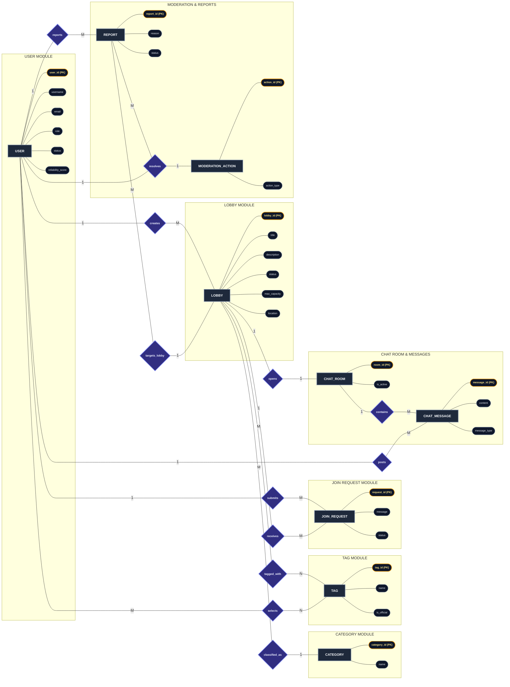
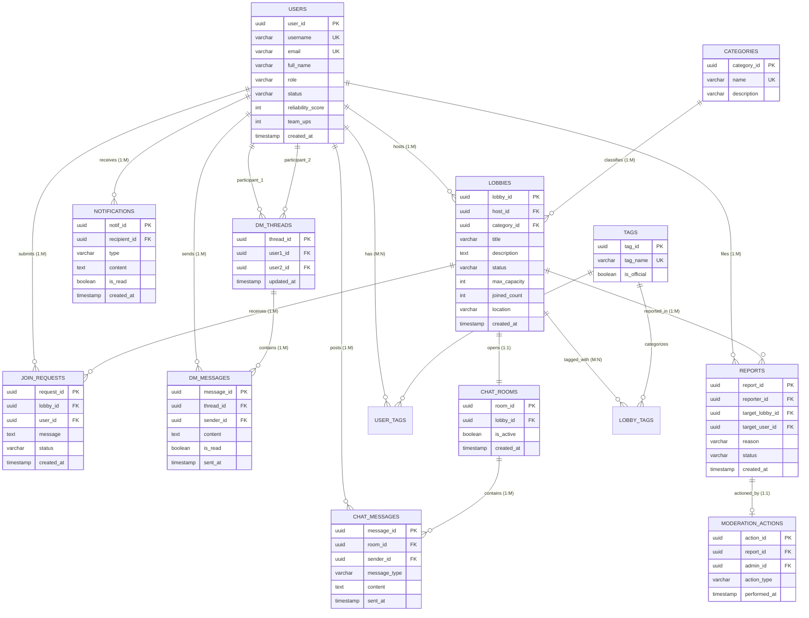

# FindMate — Entity-Relationship (ER) Diagrams

This document contains two verified, standard formats for the **FindMate** ER Diagram:

1. **Chen's ER Model (Modular Flowchart Layout)**: Rectangles (Entities), Diamonds (Relationships), Ellipses (Attributes), and Underlined PKs organized without overlapping lines.
2. **Relational Crow's Foot ER Diagram (Native Mermaid `erDiagram`)**: Clean database schema tables with Primary/Foreign Keys and data types.

---

## 1. Clean Chen's ER Diagram (Formatted with Subgraphs)

---

## 2. Standard Crow's Foot Relational Database Schema

---

## 3. Relationship & Cardinality Reference

| Relationship (Diamond) | Connection Path                                                         | Cardinality | Explanation                                                                                                 |
| :--------------------- | :---------------------------------------------------------------------- | :---------- | :---------------------------------------------------------------------------------------------------------- |
| **`creates`**          | `USER` $\rightarrow$ `LOBBY`                                            | **1 : M**   | 1 Host can create and manage multiple team-up lobbies.                                                      |
| **`classified_as`**    | `LOBBY` $\rightarrow$ `CATEGORY`                                        | **M : 1**   | Many lobbies belong to 1 category (Gaming, Coding, Sports, Study, Fitness).                                 |
| **`tagged_with`**      | `LOBBY` $\rightarrow$ `TAG`                                             | **M : N**   | Many lobbies can be tagged with multiple topic hashtags (`#valorant`, `#faang`).                            |
| **`selects`**          | `USER` $\rightarrow$ `TAG`                                              | **M : N**   | Many users select interest tags on their profile for matchmaking score calculation.                         |
| **`submits`**          | `USER` $\rightarrow$ `JOIN_REQUEST`                                     | **1 : M**   | 1 Member submits multiple join requests with custom pitch messages.                                         |
| **`receives`**         | `LOBBY` $\rightarrow$ `JOIN_REQUEST`                                    | **1 : M**   | 1 Lobby receives multiple join requests (`pending`, `accepted`, `declined`).                                |
| **`opens`**            | `LOBBY` $\rightarrow$ `CHAT_ROOM`                                       | **1 : 1**   | Each active lobby has exactly 1 group chat room for accepted members.                                       |
| **`contains`**         | `CHAT_ROOM` $\rightarrow$ `CHAT_MESSAGE`                                | **1 : M**   | 1 Chat room contains multiple chat messages.                                                                |
| **`posts`**            | `USER` $\rightarrow$ `CHAT_MESSAGE`                                     | **1 : M**   | 1 Member posts multiple messages in the lobby room.                                                         |
| **`reports`**          | `USER` $\rightarrow$ `REPORT`                                           | **1 : M**   | 1 User files multiple moderation reports.                                                                   |
| **`targets_lobby`**    | `REPORT` $\rightarrow$ `LOBBY`                                          | **M : 1**   | Multiple reports can target the same reported lobby.                                                        |
| **`resolves`**         | `USER` (Admin) $\rightarrow$ `REPORT` $\rightarrow$ `MODERATION_ACTION` | **1 : M**   | 1 Admin resolves multiple reports by executing a moderation action (`delete_lobby`, `ban_user`, `dismiss`). |
