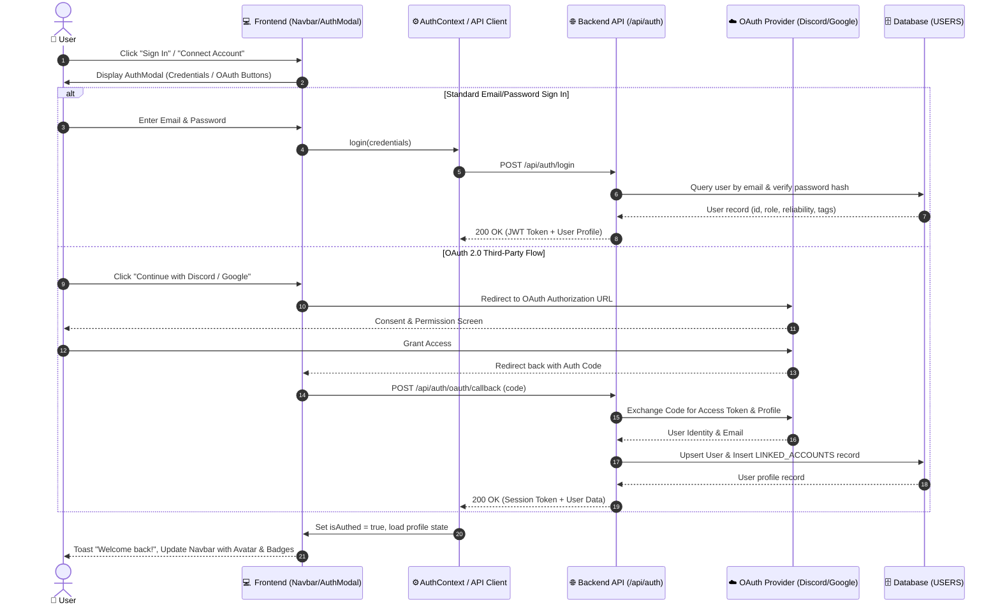
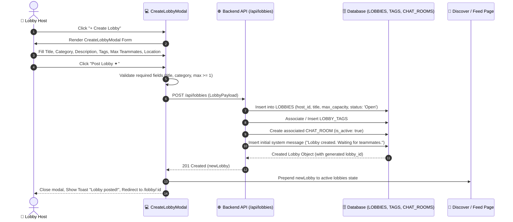
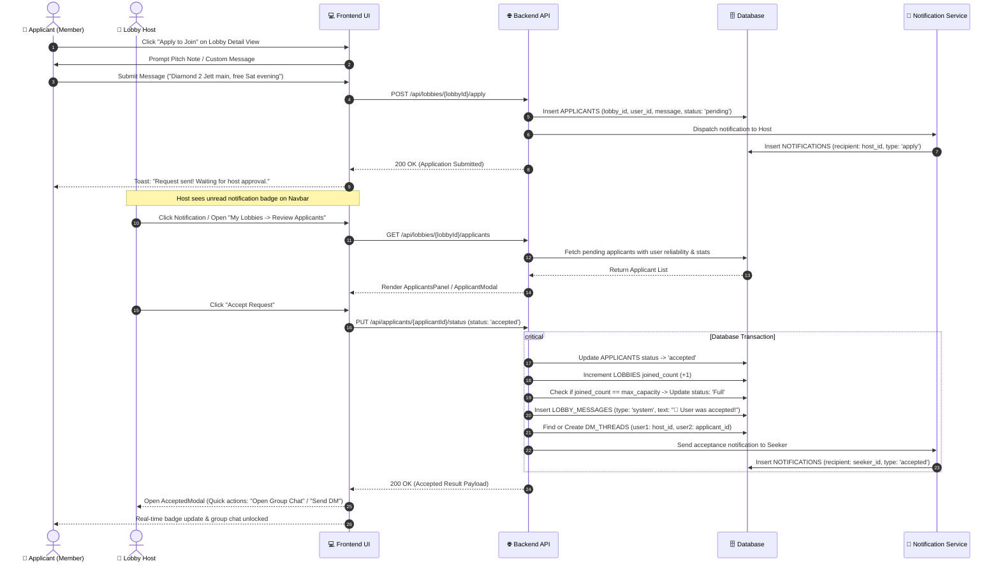
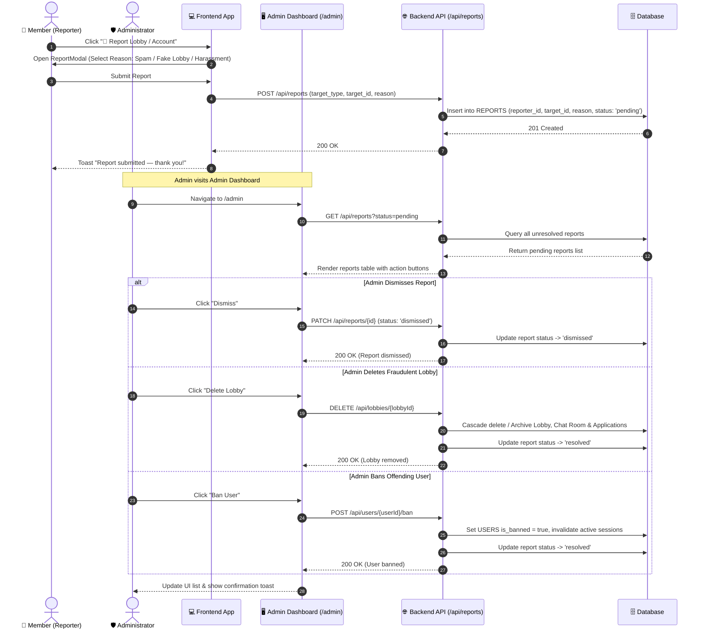

# FindMate — Sequence Diagrams

This document outlines the complete temporal interaction modeling for the **FindMate** platform.

---

## 1. How Many Sequence Diagrams Do You Need?

In software engineering, academic theses, and system architecture specifications, you need **4 to 5 Core Sequence Diagrams** to cover the primary dynamic use cases of the platform.

### The 5 Essential Sequence Diagrams:
1. **Sequence Diagram 1: User Authentication & OAuth Linking** (User sign-in, credential verification, profile load)
2. **Sequence Diagram 2: Lobby Creation & Publishing** (Host configures tags, location, capacity, and publishes lobby)
3. **Sequence Diagram 3: Application & Host Review/Approval Workflow (*The Core Engine*)** (Applying with pitch note, host notification, review, acceptance, capacity increment, system chat broadcast, and automatic DM creation)
4. **Sequence Diagram 4: Real-Time Messaging (Lobby Group Chat & 1-on-1 DMs)** (Group communication & private direct messaging with unread counter tracking)
5. **Sequence Diagram 5: Community Reporting & Admin Moderation** (User filing report, admin dashboard review, and executing ban / delete actions)

---

## 2. Sequence Diagram 1: User Authentication & OAuth Linking

> **Scenario**: A user signs in using either standard credentials or an OAuth provider (Google, Discord, GitHub), initializes their profile session, and syncs interest tags.

---

## 3. Sequence Diagram 2: Lobby Creation & Publishing

> **Scenario**: A host creates and publishes a new team-up activity with custom tags, capacity limits, and digital/in-person location details.

---

## 4. Sequence Diagram 3: Application Submission & Host Review/Approval Workflow (Core Engine)

> **Scenario**: A member applies to join an open lobby with a pitch note. The host receives an alert, inspects the applicant's reliability score, and approves the request.

---

## 5. Sequence Diagram 4: Real-Time Messaging (Group Chat & 1-on-1 DMs)

> **Scenario**: Accepted teammates communicate within the lobby group chat, while two members engage in a private 1-on-1 direct message conversation.

```mermaid
sequenceDiagram
    autonumber
    actor UserA as 👤 Member A (Sender)
    actor UserB as 👤 Member B (Recipient)
    participant UI as 💻 Chat Panel (LobbyChat / DMPanel)
    participant API as 🌐 Backend API (/api/chat)
    participant DB as 🗄️ Database (MESSAGES)

    %% Flow A: Lobby Group Chat
    rect rgb(20, 25, 40)
        note right of UserA: Scenario A: Lobby Group Chat
        UserA->>UI: Type message in LobbyChatPanel & hit Send
        UI->>API: POST /api/lobbies/{lobbyId}/messages (text, sender_id)
        API->>DB: Insert into LOBBY_MESSAGES (lobby_id, sender_id, content, sent_at)
        DB-->>API: Saved message record (msg_id, timestamp)
        API-->>UI: Broadcast message to active lobby subscribers
        UI-->>UserA: Append message to chat stream
        UI-->>UserB: Real-time append message to lobby chat stream
    end

    %% Flow B: 1-on-1 Direct Message
    rect rgb(25, 20, 35)
        note right of UserA: Scenario B: 1-on-1 Direct Messaging (DM)
        UserA->>UI: Select DM Thread with Member B & type message
        UI->>API: POST /api/dm/{threadId}/messages (text)
        API->>DB: Insert into DIRECT_MESSAGES (thread_id, sender_id, content, is_read: false)
        API->>DB: Update DM_THREADS last_message_at = NOW()
        API-->>UI: 200 OK (newDMMessage)
        UI-->>UserA: Display sent message in DM thread
        UI-->>UserB: Increment unread DM badge count & show push toast
    end
```

---

## 6. Sequence Diagram 5: Community Reporting & Admin Moderation

> **Scenario**: A user reports a fraudulent lobby or toxic user. An administrator reviews the pending report in the Admin Dashboard and takes enforcement action.

---

## 7. Summary & Traceability Table

| Diagram | Primary Actors | Main Execution Goal |
| :--- | :--- | :--- |
| **1. Auth & OAuth Flow** | User, OAuth Provider | Sign in securely, authenticate token, initialize profile & linked accounts. |
| **2. Lobby Creation Flow** | Lobby Host | Validate and store new activity with tags, capacity, and auto-created chat room. |
| **3. Application & Review Flow** | Applicant, Lobby Host, System | Full end-to-end matchmaking, approval, capacity update, system chat, and DM spawn. |
| **4. Real-time Messaging Flow** | Members (A & B) | Send & receive group chat messages and private 1-on-1 direct messages with read tracking. |
| **5. Moderation & Admin Flow** | Reporting User, Admin | Report submission, review queue, and enforcement actions (dismiss / delete lobby / ban user). |

---

## 8. How to Render or Export

1. **Draw.io (diagrams.net)**: Go to **Arrange > Insert > Advanced > Mermaid**, paste any diagram block above to convert it into draggable UML sequence lifelines.
2. **Mermaid Live Editor**: Paste into **[mermaid.live](https://mermaid.live)** to download high-resolution PNG or SVG files.
3. **VS Code**: Preview interactively in Markdown preview.

