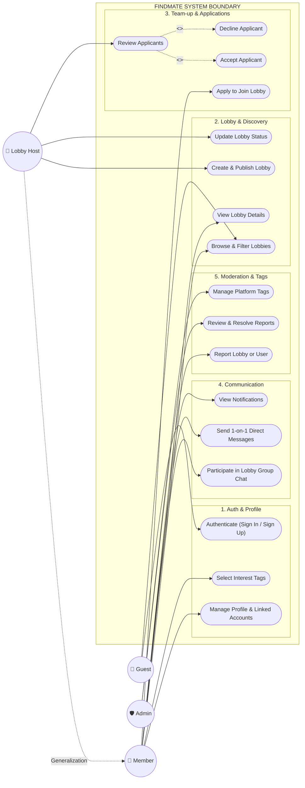
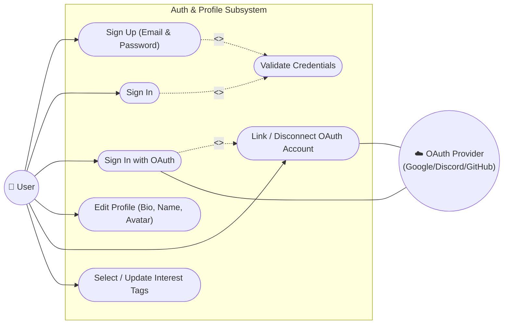
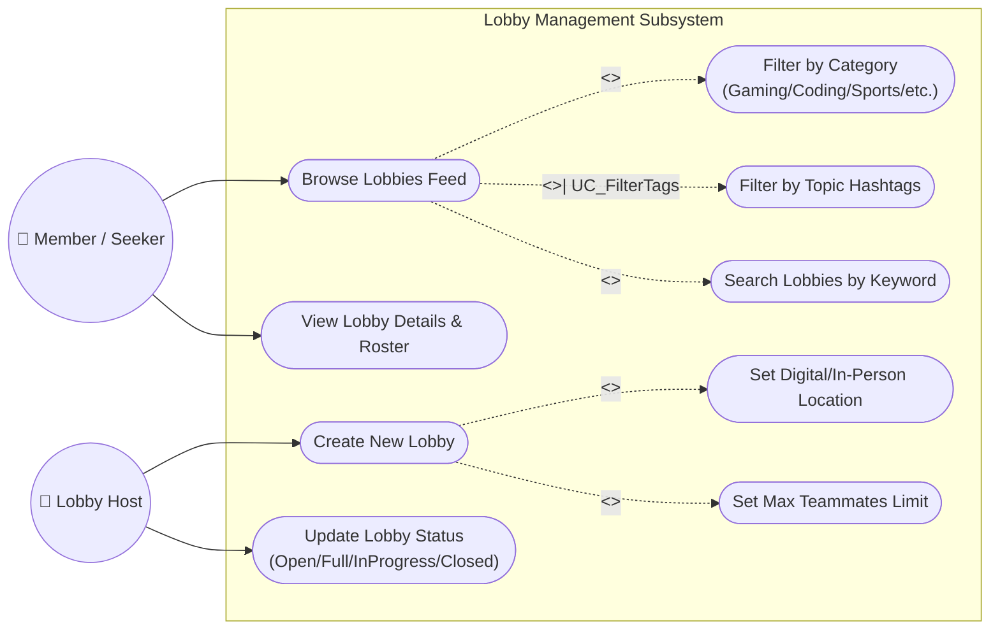
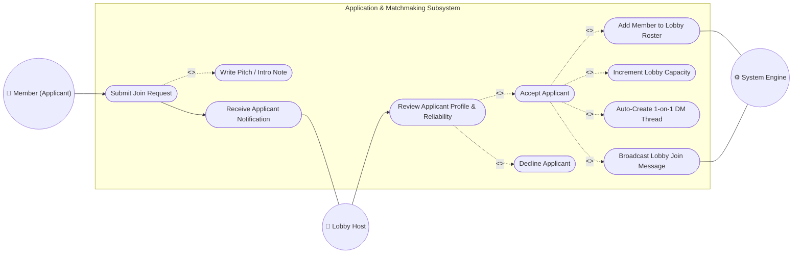
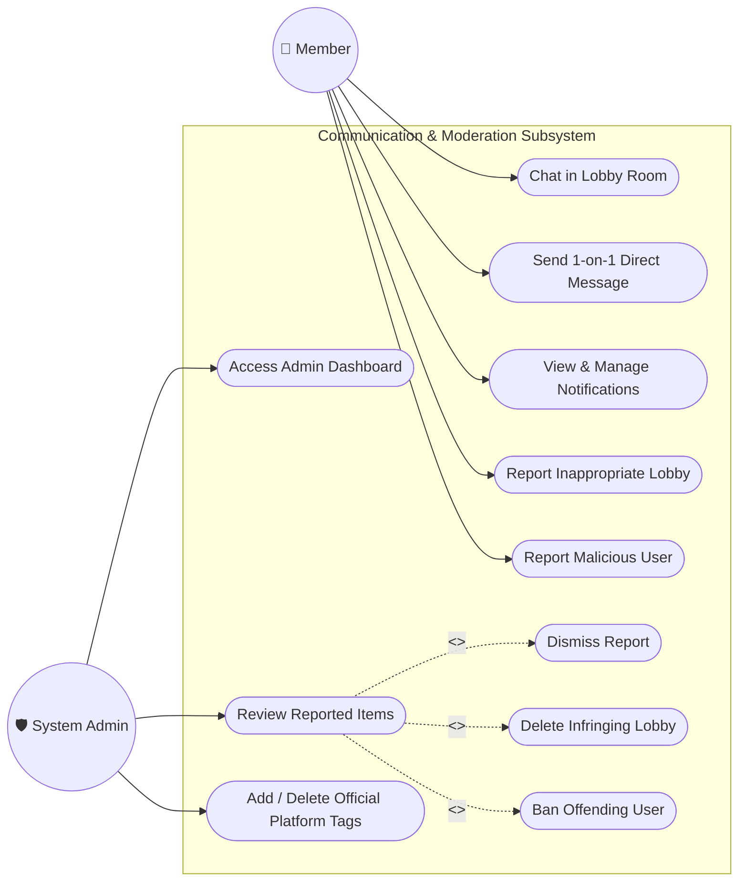

# FindMate — Use Case Diagrams

This document outlines the complete Use Case modeling for the **FindMate** platform, formatted with verified, standards-compliant Mermaid UML code.

---

## 1. How Many Use Case Diagrams Do You Need?

In software engineering and academic project reports (SRS, Thesis, Capstone), you need either:

1. **1 Master (System-Level) Use Case Diagram**: Covers the entire platform, all 4 actors, and major subsystem boundaries.
2. **4 Subsystem (Module-Level) Use Case Diagrams**: Breaks down specific workflows into detail with explicit `<<include>>` and `<<extend>>` relationships.

### Recommended Structure:

- **Diagram 0: Master System Use Case Diagram** (Complete high-level overview)
- **Diagram 1: Authentication & Profile Management Module**
- **Diagram 2: Lobby Creation & Matchmaking Discovery Module**
- **Diagram 3: Application, Review & Team-Up Workflow Module**
- **Diagram 4: Communication & Admin Moderation Module**

---

## 2. Diagram 0: Master System Use Case Diagram

---

## 3. Module-Specific Detailed Use Case Diagrams

### Diagram 1: Authentication & Profile Management

---

### Diagram 2: Lobby Creation & Discovery Module

---

### Diagram 3: Application & Matchmaking Workflow Module

---

### Diagram 4: Communication & Admin Moderation Module

---

## 4. Summary Table of Actors & Use Cases

| Actor               | Description                   | Key Use Cases                                                                                                          |
| :------------------ | :---------------------------- | :--------------------------------------------------------------------------------------------------------------------- |
| **Guest**           | Unregistered visitor          | Browse feed, view public lobby cards, open sign-in/sign-up modal.                                                      |
| **Member (Seeker)** | Registered authenticated user | Manage profile, search/filter lobbies, apply with pitch note, chat in group rooms, send DMs, submit reports.           |
| **Lobby Host**      | Member who creates a lobby    | Create lobby, configure capacity/location, update status (Open/Full), review applicants, accept/decline join requests. |
| **Admin**           | System moderator              | View pending reports, dismiss false reports, delete fraudulent lobbies, ban users, add/remove official tags.           |
| **External OAuth**  | Google / Discord / GitHub API | Authenticate identity, link connected social accounts to profile.                                                      |
