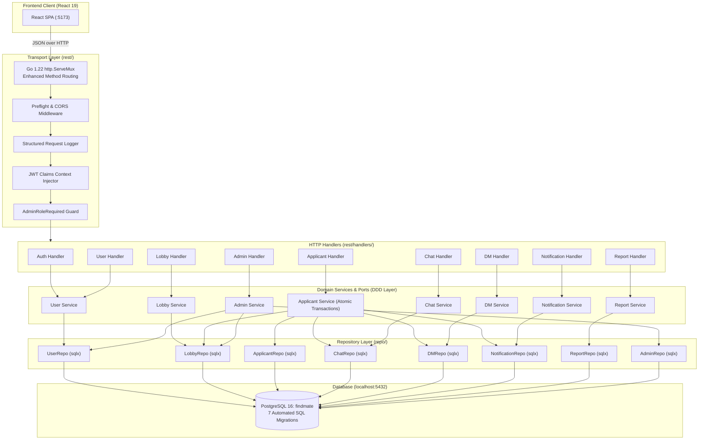

# ⚡ FindMate Backend — High-Throughput Go REST API & DDD Architecture

[](https://golang.org/)
[-indigo?style=flat-square>)](./domain/)
[](https://www.postgresql.org/)
[](https://github.com/jmoiron/sqlx)
[](./util/)
[](./)

The backend service for **FindMate** is an enterprise-grade, high-throughput REST API written in **Go (Golang) 1.22+**. It is designed following **Domain-Driven Design (DDD)** and **Clean Hexagonal Architecture** principles, backed by a persistent **PostgreSQL 16** database with automated schema migrations, JWT stateless authentication, Bcrypt password hashing, and role-based access control (RBAC).

---

## 🏛️ Architectural Highlights



### Key Technical Characteristics

1. **Native Enhanced Routing**: Leverages Go 1.22's standard library `http.ServeMux` with exact verb and path matching (`GET /api/lobbies/{id}`, `DELETE /api/notifications/{id}`) without bulky third-party router overhead.
2. **Atomic Aggregate Coordination**: The `ApplicantService` orchestrates complex state transitions: accepting an applicant atomically updates room occupancy, records accepted applicant status, broadcasts a welcome message into squad group chat, provisions a bilateral 1-on-1 DM thread, and pushes a real-time notification to the applicant.
3. **Defense-in-Depth Security**:
   - Passwords hashed with **Bcrypt** ($cost = 10$).
   - Signed **JWT** tokens (HS256) expiring in 24 hours.
   - RBAC middleware (`AdminRoleRequired`) guards moderation and governance endpoints.
   - Self-apply validation blocks lobby hosts from applying to their own squad.
4. **Real-Time Integration Ready**: Optimized for reactive polling with sub-millisecond response times, connection-leak-free queries via `sqlx.NamedExec`, and auto-updating unread counters.

---

## 📂 Directory Structure

```text
FindMate_Backend/
├── main.go                      # Application bootstrap & entry point
├── findmate-server              # Compiled production executable binary
├── go.mod                       # Go module dependency manifest
├── go.sum                       # Cryptographic checksum lockfile
├── .env.example                 # Environment configuration template
│
├── cmd/
│   └── serve.go                 # Dependency injection, repository binding & server startup
│
├── config/
│   ├── config.go                # Strong-typed environment config with fallback defaults
│   └── config_test.go           # Configuration parsing unit tests
│
├── domain/                      # Enterprise business entities (Zero external dependencies)
│   ├── user.go                  # User model & validation rules
│   ├── lobby.go                 # Micro-lobby entity & capacity bounds [2, 10]
│   ├── applicant.go             # Pitch note application entity & status enum
│   ├── chat.go                  # Squad group chat message model
│   ├── dm.go                    # 1-on-1 direct message threads & messages
│   ├── notification.go          # Interactive notification alerts
│   ├── report.go                # Incident reports & moderation triage states
│   └── tag.go                   # Taxonomy hashtags & categories
│
├── infra/
│   └── db/
│       ├── connection.go        # PostgreSQL connection pooling via sqlx
│       ├── connection_test.go   # Connection verification test
│       ├── migrate.go           # Automated SQL migration runner
│       └── migrate_test.go      # Migration parsing tests
│
├── migrations/                  # Version-controlled idempotent schema migrations
│   ├── 000001_create_users.up.sql / .down.sql
│   ├── 000002_create_categories_tags.up.sql / .down.sql
│   ├── 000003_create_lobbies.up.sql / .down.sql
│   ├── 000004_create_join_requests.up.sql / .down.sql
│   ├── 000005_create_chats_and_dms.up.sql / .down.sql
│   ├── 000006_create_reports_and_admin.up.sql / .down.sql
│   └── 000007_seed_data.up.sql / .down.sql  # 3 Real pre-seeded users
│
├── repo/                        # Data Access Layer (PostgreSQL / sqlx)
│   ├── user_repo.go             # User retrieval, creation, rating aggregation
│   ├── lobby_repo.go            # Lobby filtering, sorting, joined count queries
│   ├── applicant_repo.go        # Applicant status mutations & ID lookup
│   ├── chat_repo.go             # Group chat history & insertion
│   ├── dm_repo.go               # Bilateral DM thread tracking & unread flags
│   ├── notification_repo.go     # Notification creation, read toggles, and deletion
│   ├── report_repo.go           # Community incident filing & admin triage
│   └── admin_repo.go            # Immutable audit logs, announcements, tag curation
│
├── rest/                        # HTTP Transport Layer
│   ├── server.go                # Server router assembly & handler registration
│   ├── server_test.go           # Comprehensive HTTP endpoint integration test suite
│   ├── middlewares/             # Composable HTTP middleware pipeline
│   │   ├── middleware.go        # Middlewares struct & config reference
│   │   ├── manager.go           # Clean handler chaining wrapper (manager.With)
│   │   ├── cors.go              # Cross-Origin Resource Sharing headers
│   │   ├── preflight.go         # OPTIONS preflight request short-circuiter
│   │   ├── logger.go            # Latency, status code, and IP request logging
│   │   ├── authenticate_jwt.go  # Bearer token verification & Context injector
│   │   └── admin_rbac.go        # 403 Forbidden enforcement for non-admins
│   └── handlers/                # HTTP Controller layer
│       ├── auth/                # Register, Login, Me endpoints
│       ├── user/                # User directory, profile updates, rating submission
│       ├── lobby/               # Lobby discovery, lifecycle, pitch application
│       ├── applicant/           # Applicant review queue & approval/rejection
│       ├── chat/                # Squad group chat history & message sending
│       ├── dm/                  # Direct message threads, messages, and mark-read
│       ├── notification/        # Notifications query, mark-read, and deletion
│       ├── report/              # Community reporting & incident resolution
│       └── admin/               # Governance KPI metrics, audit trail, user bans
│
├── user/                        # User Domain Service & Port interface
├── lobby/                       # Lobby Domain Service & Port interface
├── applicant/                   # Applicant Domain Service & Port interface
├── chat/                        # Chat Domain Service & Port interface
├── dm/                          # Direct Message Domain Service & Port interface
├── notification/                # Notification Domain Service & Port interface
├── report/                      # Moderation Report Domain Service & Port interface
├── admin/                       # Admin Governance Domain Service & Port interface
│
└── util/                        # Shared Cross-Cutting Utilities
    ├── jwt.go                   # JWT claims signing and verification
    ├── avatar.go                # Algorithmic two-letter initials generator
    ├── send_data.go             # Standardized JSend success responder
    └── send_page.go             # Standardized error and pagination responders
```

---

## 🗄️ Database Schema & Migrations

The database schema is divided into 7 idempotent, bidirectional SQL migration scripts executed on startup:

| Migration File                           | Primary Tables Created                                        | Description                                                                             |
| :--------------------------------------- | :------------------------------------------------------------ | :-------------------------------------------------------------------------------------- |
| `000001_create_users.up.sql`             | `users`, `user_ratings`                                       | User accounts, hashed passwords, reliability scores, and 1-5 star peer reviews.         |
| `000002_create_categories_tags.up.sql`   | `categories`, `tags`                                          | Official taxonomy categories (`Gaming`, `Coding`, etc.) and indexed hashtags.           |
| `000003_create_lobbies.up.sql`           | `lobbies`                                                     | Micro-lobbies with capacity constraints ($2 \le \text{max} \le 10$), status, and tags.  |
| `000004_create_join_requests.up.sql`     | `join_requests`                                               | Teammate applications containing structured pitch notes ([5, 300] characters).          |
| `000005_create_chats_and_dms.up.sql`     | `chat_messages`, `dm_threads`, `dm_messages`, `notifications` | Squad chats, bilateral direct message threads, messages, and interactive notifications. |
| `000006_create_reports_and_admin.up.sql` | `reports`, `audit_logs`, `announcements`                      | Incident reports, append-only administrative audit logs, and broadcast banners.         |
| `000007_seed_data.up.sql`                | _Data Population_                                             | Seeds exactly 3 real user accounts with Bcrypt password `1234`.                         |

### Pre-Seeded Real Production Accounts

| Name                      | Handle         | Email                   | System Role | Initial Password | Profile Avatar |
| :------------------------ | :------------- | :---------------------- | :---------: | :--------------: | :------------: |
| **Abu Nasim**             | `@Error-nasim` | `nasim@findmate.local`  |   `admin`   |      `1234`      |      `AN`      |
| **Rimon Chandra Bhowmik** | `@rimon21`     | `rimon@findmate.local`  |  `member`   |      `1234`      |      `RB`      |
| **Al Imtiaz**             | `@imtiaz11`    | `imtiaz@findmate.local` |  `member`   |      `1234`      |      `AI`      |

---

## 🌐 Complete REST API Specification

All API endpoints are prefixed with `/api`. Responses adhere to a consistent JSON envelope:

- **Success**: `{"data": <payload>, "status": 200, "success": true}`
- **Error**: `{"error": "<error message>", "status": 400, "success": false}`

### 1. Authentication (`/api/auth`)

| Method | Endpoint             |    Auth    | Description                                                                           |
| :----- | :------------------- | :--------: | :------------------------------------------------------------------------------------ |
| `POST` | `/api/auth/register` |    None    | Register a new user account with Name, Handle, Email, Password, and Tags.             |
| `POST` | `/api/auth/login`    |    None    | Authenticate with Handle/Email + Password. Returns User profile and signed JWT token. |
| `GET`  | `/api/auth/me`       | Bearer JWT | Returns current authenticated user claims.                                            |

### 2. User Directory & Ratings (`/api/users`)

| Method | Endpoint               |    Auth    | Description                                                              |
| :----- | :--------------------- | :--------: | :----------------------------------------------------------------------- |
| `GET`  | `/api/users`           |    None    | List all active users with reliability scores and ratings.               |
| `GET`  | `/api/users/{id}`      |    None    | Get detailed user dossier by ID or `@handle`.                            |
| `PUT`  | `/api/users/{id}`      | Bearer JWT | Update authenticated user profile (name, bio, tags, connected accounts). |
| `POST` | `/api/users/{id}/rate` | Bearer JWT | Submit a 1-5 star teammate rating with feedback note.                    |

### 3. Lobbies & Pitch Applications (`/api/lobbies`)

| Method   | Endpoint                       |    Auth    | Description                                                                                  |
| :------- | :----------------------------- | :--------: | :------------------------------------------------------------------------------------------- |
| `GET`    | `/api/lobbies`                 |    None    | List active lobbies with optional search, category, and tag filters.                         |
| `POST`   | `/api/lobbies`                 | Bearer JWT | Create a micro-lobby ($2 \le \text{max} \le 10$). Automatically initializes squad chat room. |
| `GET`    | `/api/lobbies/{id}`            |    None    | Retrieve single lobby details with real-time joined and pending metrics.                     |
| `PUT`    | `/api/lobbies/{id}`            | Bearer JWT | Update lobby metadata (host only).                                                           |
| `PATCH`  | `/api/lobbies/{id}/status`     | Bearer JWT | Transition lobby status (`Open`, `Full`, `Completed`, `Closed`).                             |
| `DELETE` | `/api/lobbies/{id}`            | Bearer JWT | Delete lobby (host or admin).                                                                |
| `POST`   | `/api/lobbies/{id}/apply`      | Bearer JWT | Submit join application with pitch note ([5, 300] chars). Blocks host self-pitch.            |
| `GET`    | `/api/lobbies/{id}/applicants` | Bearer JWT | List join applications for this lobby.                                                       |

### 4. Applicant Decision Engine (`/api/applicants`)

| Method | Endpoint                      |    Auth    | Description                                                                                                                                       |
| :----- | :---------------------------- | :--------: | :------------------------------------------------------------------------------------------------------------------------------------------------ |
| `GET`  | `/api/applicants`             | Bearer JWT | List all submitted applications across lobbies.                                                                                                   |
| `PUT`  | `/api/applicants/{id}/status` | Bearer JWT | Accept or decline applicant. On accept: increments joined count, broadcasts squad welcome message, provisions DM thread, and pushes notification. |

### 5. Squad Group Chat (`/api/lobbies/{id}/messages`)

| Method | Endpoint                     |    Auth    | Description                                                           |
| :----- | :--------------------------- | :--------: | :-------------------------------------------------------------------- |
| `GET`  | `/api/lobbies/{id}/messages` |    None    | Fetch chronological squad group chat history.                         |
| `POST` | `/api/lobbies/{id}/messages` | Bearer JWT | Post message to squad group chat with authenticated user credentials. |

### 6. Direct Messaging (`/api/dm`)

| Method  | Endpoint                      | Auth | Description                                                                                |
| :------ | :---------------------------- | :--: | :----------------------------------------------------------------------------------------- |
| `GET`   | `/api/dm/threads`             | None | List all active 1-on-1 direct message conversations with unread indicators.                |
| `POST`  | `/api/dm/threads`             | None | Create or retrieve bilateral DM conversation thread between two users.                     |
| `GET`   | `/api/dm/{threadId}/messages` | None | Retrieve conversation message history for a DM thread.                                     |
| `POST`  | `/api/dm/{threadId}/messages` | None | Send message in DM thread. Automatically increments unread flag and triggers notification. |
| `PATCH` | `/api/dm/{threadId}/read`     | None | Mark DM thread as read, resetting unread counter to 0.                                     |

### 7. Interactive Notifications (`/api/notifications`)

| Method   | Endpoint                       | Auth | Description                                                 |
| :------- | :----------------------------- | :--: | :---------------------------------------------------------- |
| `GET`    | `/api/notifications`           | None | Query notifications list with unread flags and timestamps.  |
| `POST`   | `/api/notifications`           | None | Publish notification alert for a specific recipient.        |
| `PATCH`  | `/api/notifications/{id}/read` | None | Mark specific notification as read.                         |
| `PATCH`  | `/api/notifications/read-all`  | None | Mark all notifications as read.                             |
| `DELETE` | `/api/notifications/{id}`      | None | Delete individual notification permanently from PostgreSQL. |
| `DELETE` | `/api/notifications`           | None | Clear all notifications from PostgreSQL.                    |

### 8. Incident Reporting & Moderation (`/api/reports`)

| Method  | Endpoint            |    Auth    | Description                                                |
| :------ | :------------------ | :--------: | :--------------------------------------------------------- |
| `GET`   | `/api/reports`      | Bearer JWT | List filed community incident reports.                     |
| `POST`  | `/api/reports`      | Bearer JWT | File a report against an infringing lobby or abusive user. |
| `PATCH` | `/api/reports/{id}` | Admin RBAC | Resolve or dismiss report with admin action notes.         |

### 9. Admin Control Center (`/api/admin`)

| Method   | Endpoint                        |    Auth    | Description                                                        |
| :------- | :------------------------------ | :--------: | :----------------------------------------------------------------- |
| `GET`    | `/api/admin/audit-logs`         | Admin RBAC | List immutable audit trail with optional action and search filter. |
| `POST`   | `/api/admin/audit-logs`         | Admin RBAC | Record new administrative governance action.                       |
| `GET`    | `/api/admin/announcements`      |    None    | Retrieve active platform broadcast announcements.                  |
| `POST`   | `/api/admin/announcements`      | Admin RBAC | Broadcast system-wide banner announcement.                         |
| `DELETE` | `/api/admin/announcements/{id}` | Admin RBAC | Revoke / delete broadcast banner.                                  |
| `GET`    | `/api/admin/tags`               |    None    | List curated taxonomy tags with usage counts.                      |
| `POST`   | `/api/admin/tags`               | Admin RBAC | Add official platform hashtag.                                     |
| `DELETE` | `/api/admin/tags/{name}`        | Admin RBAC | Remove official hashtag.                                           |
| `POST`   | `/api/admin/users/ban`          | Admin RBAC | Ban user from platform; generates immutable audit log.             |
| `POST`   | `/api/admin/users/unban`        | Admin RBAC | Restore banned user account.                                       |
| `DELETE` | `/api/admin/lobbies/{id}`       | Admin RBAC | Force-delete infringing lobby with reason tracking.                |

---

## 🚀 Setup & Execution Guide

### Prerequisites

- **Go**: `v1.22` or higher installed ([Download Go](https://golang.org/dl/))
- **PostgreSQL**: `16.x` active on `localhost:5432` ([Download PostgreSQL](https://www.postgresql.org/download/))

### 1. Database Configuration

Ensure the `findmate` database exists in PostgreSQL:

```bash
# Connect to PostgreSQL and create database
psql -U postgres -c "CREATE DATABASE findmate;"
```

### 2. Configure Environment Variables

Copy `.env.example` to `.env` or verify the default connection settings:

```bash
cp .env.example .env
```

Default configuration values:

```env
SERVICE_NAME=findmate-backend
HTTP_PORT=8080
JWT_SECRET_KEY=findmate_secure_jwt_secret_key_2026
DB_HOST=localhost
DB_PORT=5432
DB_USER=postgres
DB_PASSWORD=add_your_password_here
DB_NAME=findmate
DB_SSL_MODE=disable
```

### 3. Run Automated Tests

Execute the entire Go backend unit and integration test suite:

```bash
# Run all package tests
go test -v ./...

# Run top-level suite
go test -v
```

### 4. Build and Launch Server

```bash
# Build production binary
go build -o findmate-server main.go

# Start server
./findmate-server
```

Upon startup, the migration runner automatically executes all 7 migrations, seeds the 3 real users, and starts listening on:

```text
Successfully applied 0 database migration(s)
FindMate REST API Server listening on http://localhost:8080
```

---

## 🔒 Security & Middleware Pipeline

1. **Preflight Short-Circuit**: Responds immediately with HTTP 200 OK to all browser `OPTIONS` preflight checks.
2. **CORS Governance**: Configured to permit requests from `http://localhost:5173` with credentials and standard headers (`Authorization`, `Content-Type`).
3. **JWT Context Extraction**: Verifies `Bearer <token>` on protected routes, extracts claims (`UserID`, `Username`, `Role`), and binds them to the `http.Request` context.
4. **Admin RBAC Enforcement**: Handlers wrapped with `manager.WithAdmin(h)` strictly verify `role == "admin"`. Unauthorized requests are rejected immediately with `403 Forbidden: Administrative privileges required`.
5. **Self-Apply Guard**: `applicant.Service` evaluates applicant credentials against lobby host ownership, preventing hosts from pitching or joining their own lobbies.

---

## 👥 Authors & Maintainers

- **Abu Nasim** ([`@Error-nasim`](https://github.com/Error-nasim)) — Lead Architect & Core Backend Engineer
- **Rimon Chandra Bhowmik** ([`@rimon21`](https://github.com/rimon21)) — QA Engineer & Documentation Lead
- **Academic Supervisor**: **Al Imtiaz**, Associate Professor, Department of Computer Science & Engineering, UITS.
