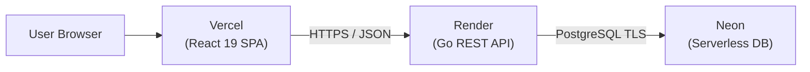

<div align="center">

# ⚡ FindMate

**Instant Teammate Matchmaking & Micro-Lobby Collaboration Platform**  
_No Event Planning Overhead. No Discord Clutter. Zero Ghosting._

[](https://findmate-psi.vercel.app/)
[](https://findmate-dctf.onrender.com/api/health)
[](https://neon.tech/)

[](https://react.dev/)
[](https://vitejs.dev/)
[](https://tailwindcss.com/)
[](https://golang.org/)
[](./.github/workflows/test.yml)
[-brightgreen?style=flat-square>)](./tests/README.md)
[](./tests/evidence/coverage_summary.txt)
[](./docs/Reports/final/Final_Report.md)
[-emerald?style=flat-square>)](./docs/Schedule/FindMate_14_Week_Gantt_Schedule.xlsx)
[](https://appeal-rich-26498266.figma.site)

<p align="center">
  <a href="#-live-production-deployment">Live Demo</a> •
  <a href="#-overview">Overview</a> •
  <a href="#-key-features">Key Features</a> •
  <a href="#-system-architecture--diagrams">Architecture</a> •
  <a href="#-14-week-schedule--gantt-chart">Gantt Schedule</a> •
  <a href="#-tech-stack">Tech Stack</a> •
  <a href="#-cloud-deployment-100-free">Deployment</a> •
  <a href="#-getting-started">Local Setup</a> •
  <a href="#-testing--verification-protocol">Testing & CI</a> •
  <a href="#-team--acknowledgments">Team</a>
</p>

</div>

---

## 🚀 Live Production Deployment

FindMate is fully deployed to production on a **100% free, high-performance cloud stack** with automated CI/CD:

| Component | Platform | Live URL / Endpoint | Details |
| :--- | :--- | :--- | :--- |
| **Frontend Web App** | **Vercel** | [**https://findmate-psi.vercel.app/**](https://findmate-psi.vercel.app/) | React 19 SPA, global edge CDN, automated Git CD, instant SPA routing. |
| **REST API Microservice** | **Render** | [`https://findmate-dctf.onrender.com`](https://findmate-dctf.onrender.com/api/health) | Go 1.22 compiled native binary, Docker runtime in AWS Singapore. |
| **Relational Database** | **Neon** | Serverless PostgreSQL 18.6 | Managed pooled connection, 7 automated SQL schema migrations. |
| **OAuth 2.0 Providers** | Google, Discord, Meta | `/auth/callback` | Cross-platform real-time authentication & account linking. |

> **🔑 Live Test Accounts (Pre-Seeded in Neon DB)**:
> - **Member 1**: `@rimon21` *(or `rimon@findmate.local`)* — Password: `1234`
> - **Member 2**: `@imtiaz11` *(or `imtiaz@findmate.local`)* — Password: `1234`
> - **Direct Admin Portal**: [https://findmate-psi.vercel.app/admin](https://findmate-psi.vercel.app/admin) (passcode protected)
> - **Live OAuth 2.0**: Sign in directly with your personal **Google**, **Discord**, or **Meta** accounts.

---

## 📖 Overview

**FindMate** is an instant team-up and matchmaking platform designed for competitive gamers, hackathon developers, sports enthusiasts, and study squads.

Traditional platforms force users through cumbersome event planning tools, rigid calendar invites, or noisy Discord servers. FindMate cuts through the friction:

- **Lobby-First Architecture**: Create or discover micro-lobbies with real-time capacity counters.
- **Tag-Driven Matchmaking**: Intelligent compatibility scoring based on shared interests and taxonomy tags.
- **Application Pitch Vetting Engine**: Prospective teammates apply with custom pitch notes; hosts review applicant reliability and approve with one click.
- **Automated Communication**: Instant squad group chat channels provisioned upon approval, with private 1-on-1 direct messaging threads.
- **Admin Control Center**: Comprehensive moderation dashboard for report triage, user access governance, lobby lifecycles, and audit logging.

---

## ✨ Key Features

### 🎮 1. Dynamic Lobby Discovery & Filtering

- **Multi-Category Feeds**: Browse lobbies across `Gaming`, `Coding`, `Sports`, `Fitness`, and `Study`.
- **Topic Hashtags & Search**: Real-time filtering by tags (e.g., `#valorant`, `#leetcode`, `#hackathon`, `#faang`).
- **Match Compatibility Score**: Dynamic percentage score calculating alignment between host taxonomy requirements and user profile tags.
- **Location Modes**: Support for digital channels (Discord servers, Zoom links) and physical campus locations.

### 👑 2. Application Pitch & Vetting Flow

- **Structured Pitch Notes**: Seekers submit focused introduction notes detailing rank, role, availability, and background ($5-300$ chars).
- **Host Review Queue**: Hosts inspect applicant reliability percentages, past team-ups, and connected accounts.
- **Atomic Slot Locking**: Approvals automatically update lobby capacity, broadcast a squad announcement, and spawn a direct messaging thread.
- **Application Cancellation (`Cancel Request`)**: Seekers can withdraw their pending applications at any time from the Discover Feed, Lobby Detail View, or My Lobbies Page, atomically decrementing the lobby's pending counter.
- **Roster Kick & Clean Re-Application**: Hosts can remove members from the squad roster, automatically decrementing joined count, reopening the lobby if it was Full, broadcasting a squad departure alert, and allowing the kicked member to re-apply fresh without cached state conflicts.

### 💬 3. Integrated Real-Time Messaging & Isolated Notification Center

- **Zero-Refresh Real-Time Engine**: Built-in reactive synchronization polls active chat and DM channels every 1.5 seconds and global state every 3 seconds, delivering real-time messages and notifications without page reloads.
- **Lobby Squad Chat**: Dedicated group chat room automatically provisioned for host and approved teammates upon admission.
- **1-on-1 Direct Messaging (DMs)**: Private bilateral chat threads with auto-updating unread badges and instant slide-in panel from user profiles.
- **Navbar Unread Message Counter**: High-visibility `#F43F5E` red pill counter on both Desktop and Mobile navigation bars whenever incoming messages arrive.
- **Zero-Leak Data Isolation**: Brand-new users start with a clean slate (0 DMs, 0 unread messages, 0 notifications). Demo and fake data are completely excluded.
- **Strict Separation of Messages & Notifications**: Chat and DM messages are strictly isolated to the `/messages` page and Messages badge. Notifications panel strictly handles platform events (lobby applications, approvals, kicks, session reviews, admin alerts) with click-to-action shortcuts.
- **Interactive Notification Center**: Dropdown notification panel with single-click individual deletion (`🗑️`), complete notification clearance (`Clear all`), and database-level duplicate rejection.

### 🛡️ 4. Full-Featured Admin Control Center (`/admin`)

- **Role Governance & Super Admin Hierarchy**:
  - **Abu Nasim (`@Error-nasim`)** is the permanent root Super Admin and cannot be demoted, banned, or deleted.
  - Nasim has the exclusive privilege to promote Admins to Super Admin. Super Admins can manage and demote other Super Admins.
  - **Two-Factor Access Guard**: Direct links to `/admin` prompt unauthorized users for BOTH administrative username and passcode credentials.
- **Banned User Sandbox**: Banned users (`isBanned: true`) retain read access to view past activity and lobbies, but all write/interactive capabilities (creating lobbies, applying, squad/DM chat, rating) are securely disabled.
- **User Deletion & Governance**: Searchable member directory with user deletion by admin, reliability adjustments (`+2%` boost / `-5%` penalty), and instant ban/unban enforcement.
- **Executive KPI Dashboard**: Live platform metrics tracking total users (active vs. banned), open vs. completed lobbies, squad completion percentage, and average reliability score.
- **Multi-Status Moderation Queue**: Triage incident reports across `Pending`, `Resolved`, and `Dismissed` with evidence inspection and action execution (`Delete Lobby`, `Ban User`, `Dismiss`).
- **Lobby & Squad Oversight**: Monitor active lobbies, inspect chat messages, force-complete sessions, and pin featured lobbies (`📌 Featured`).
- **Tag Taxonomy Management**: Curate official hashtags with live usage statistics across active lobbies and interested users.
- **Global Broadcast Banners**: Publish real-time global announcement banners (`Info`, `Warning`, `Alert`, `Celebration`) displayed across all active sessions.
- **Immutable Audit Trail**: Append-only administrative activity log with one-click JSON export.

### 🔑 5. Real-Time OAuth 2.0 & Multi-Account Linking

- **Native Provider Support**: One-click authentication with **Google**, **Discord**, and **Facebook** OAuth 2.0.
- **Cross-Platform Account Linking**: Authenticate with any provider (e.g. Google), then link additional third-party accounts (Discord, Facebook) in the profile page to enable seamless login from any connected provider.
- **Manual Authentication**: Clean credential sign-in without test user shortcuts.

### 📧 6. Dynamic Email Verification & Password Recovery

- **Real OTP Email Delivery**: Sends 6-digit verification codes to any user's email address during registration and password reset.
- **Render-Friendly HTTPS API (EmailJS & Resend)**: Delivers emails over standard HTTPS (Port 443) via EmailJS (personal Gmail relay) or Resend, completely bypassing cloud container SMTP port blocks (Render Free Tier blocks port 587).
- **Security & Expiration**: 15-minute token TTL, attempt rate-limiting, and 60-second resend cooldown backed by Neon PostgreSQL (`verification_codes` table).
- **Clean Reset UX**: Does not auto-login on reset; redirects to the Sign In screen with a pre-filled email and success confirmation banner.

### 🎨 7. Modern UI & Theme System

- **Dual Theme Engine**: Seamless light and dark mode toggling powered by CSS variables and local storage persistence.
- **Responsive Layout**: Desktop capsule pill navigation and mobile-optimized bottom navigation drawer.
- **Figma Precision**: Faithful implementation of the official [FindMate Figma UI Specification](https://appeal-rich-26498266.figma.site).

---

## 🏛️ System Architecture & Diagrams

FindMate's architecture is comprehensively modeled across formal UML, entity-relationship, and sequence specifications:

| Model Category                      | Document Reference                                                                                         |     Formats      | Description                                                                         |
| :---------------------------------- | :--------------------------------------------------------------------------------------------------------- | :--------------: | :---------------------------------------------------------------------------------- |
| **Entity-Relationship Model (ERD)** | [`docs/Diagrams/ER_Diagram.md`](./docs/Diagrams/ER_Diagram.md)                                             | Mermaid, Draw.io | Chen's modular ER model & standard Crow's Foot relational schema.                   |
| **Visual Relational Schema**        | [`docs/Diagrams/ER Diagram.drawio`](./docs/Diagrams/ER%20Diagram.drawio)                                   |   Draw.io XML    | Native vector diagram file for [diagrams.net (draw.io)](https://app.diagrams.net/). |
| **System Sequence Diagrams**        | [`docs/Diagrams/Sequence_Diagram.md`](./docs/Diagrams/Sequence_Diagram.md)                                 | Mermaid, Draw.io | 5 temporal lifelines: Auth, Lobby CRUD, Pitch Vetting, Messaging, and RBAC.         |
| **Use Case Diagrams**               | [`docs/Diagrams/Usecase Diagram/UseCase_Diagram.md`](./docs/Diagrams/Usecase%20Diagram/UseCase_Diagram.md) | Mermaid, Draw.io | High-level system boundary diagram and 4 subsystem-level use cases.                 |

```
docs/Diagrams/
├── ER_Diagram.md                          # Chen's ER Model & Crow's Foot Relational Schema
├── ER Diagram.drawio                      # Visual relational schema for draw.io
├── Sequence_Diagram.md                    # 5 Core temporal lifecycle sequences
├── Sequence Diagram/
│   ├── User Auth Sequence.drawio
│   ├── Lobby Sequence.drawio
│   ├── Aplication Submission Sequence.drawio
│   ├── Messaging Sequence.drawio
│   └── Report & Admin Sequence.drawio
└── Usecase Diagram/
    ├── UseCase_Diagram.md                 # Master & module-level use case specifications
    ├── Main UseCase.drawio
    ├── Auth Usecase.drawio
    ├── Lobby Usecase.drawio
    ├── Aplication Usecase.drawio
    └── Communication Usecase.drawio
```

---

## 📅 14-Week Schedule & Gantt Chart

The project was executed across a 14-week lifecycle adhering to Agile Scrum principles structured into four Unified Process phases:

- 📊 **Interactive Excel Workbook**: [`docs/Schedule/FindMate_14_Week_Gantt_Schedule.xlsx`](./docs/Schedule/FindMate_14_Week_Gantt_Schedule.xlsx) _(also available in [`Downloads`](file:///home/user/Downloads/FindMate_14_Week_Gantt_Schedule.xlsx))_
- 📑 **Comprehensive Schedule Report**: [`docs/Schedule/Project_Schedule_Gantt.md`](./docs/Schedule/Project_Schedule_Gantt.md)
- 📄 **Universal CSV Timeline**: [`docs/Schedule/FindMate_14_Week_Gantt_Schedule.csv`](./docs/Schedule/FindMate_14_Week_Gantt_Schedule.csv)

### Work Breakdown Structure (WBS) & Milestones

|  Gate  |  Week   | Milestone Title                       | Key Deliverable                                   | Attainment Record               |
| :----: | :-----: | :------------------------------------ | :------------------------------------------------ | :------------------------------ |
| **M1** | Week 2  | **SRS & Feasibility Approved**        | Functional & non-functional specifications        | **PASSED** (0-day variance)     |
| **M2** | Week 4  | **System Architecture Baselined**     | Chen ERD, Crow's Foot schema & Sequence models    | **PASSED** (Design baselined)   |
| **M3** | Week 7  | **Core Engine MVP Operational**       | JWT auth, OAuth providers, and lobby creation     | **PASSED** (MVP verified)       |
| **M4** | Week 8  | **Mid-Term Evaluation Defense**       | Discover feed, pitch vetting, and squad chat demo | **PASSED** (Actions integrated) |
| **M5** | Week 10 | **QA Test Verification Exit Gate**    | 31 automated tests, 99.00% line coverage          | **PASSED** (Exit criteria met)  |
| **M6** | Week 12 | **Multi-Job CI/CD Operational**       | GitHub Actions multi-job runners (Node + Go)      | **PASSED** (Automated on push)  |
| **M7** | Week 13 | **Final Viva Voce & Demonstration**   | End-to-end platform defense to instructor         | **PASSED** (Defense approved)   |
| **M8** | Week 14 | **Official Project Release (v1.0.0)** | 13-section capstone report & v1.0.0 release tag   | **PASSED** (Capstone delivered) |

---

## 🛠️ Tech Stack

### Frontend (`/FindMate_Frontend`)

| Technology       | Version   | Description                                                  |
| :--------------- | :-------- | :----------------------------------------------------------- |
| **React**        | `v19.0.0` | Declarative component UI library with modern Context & Hooks |
| **Vite**         | `v6.0.0`  | Next-generation ESM bundler and ultra-fast dev server        |
| **Tailwind CSS** | `v3.4.1`  | Utility-first CSS framework with custom design tokens        |
| **React Router** | `v6.28.0` | Declarative client-side routing with nested layouts          |
| **Axios**        | `v1.7.9`  | Promise-based HTTP client with environment-aware baseURL     |

### Backend ([`/FindMate_Backend`](./FindMate_Backend/README.md))

| Technology | Version | Description |
| :--- | :--- | :--- |
| **Go (Golang)** | `1.22+` | High-throughput, low-latency compiled runtime with DDD architecture |
| **Standard Router** | `Go 1.22 http.ServeMux` | Native enhanced verb and pattern-based HTTP routing |
| **sqlx** | `v1.4.0` | Ergonomic extensions to Go's standard `database/sql` library |
| **PostgreSQL** | `16.0+` | Relational ACID database with automated SQL migrations |
| **JWT & Bcrypt** | `golang-jwt/v5`, `bcrypt` | Stateless bearer token authentication & salted password hashing |

---

## 📂 Project Structure

```text
Findmate/
├── .github/
│   └── workflows/
│       └── test.yml                      # Automated multi-job CI/CD pipeline (Node + Go)
├── docs/                                 # Central project documentation repository
│   ├── README.md                         # Master documentation index & deliverable hub
│   ├── Diagrams/                         # System UML, ER, and Sequence design specifications
│   │   ├── ER_Diagram.md                 # Chen's ER model & Crow's foot relational schema
│   │   ├── ER Diagram.drawio             # Vector schema diagram for draw.io
│   │   ├── Sequence_Diagram.md           # 5 Temporal lifecycle sequence diagrams
│   │   ├── Usecase Diagram/              # Master and 4 subsystem use case models
│   │   └── Sequence Diagram/             # Draw.io files for all sequence flows
│   ├── Schedule/                         # 14-Week project schedule & Gantt deliverables
│   │   ├── FindMate_14_Week_Gantt_Schedule.xlsx # Interactive Excel Gantt workbook
│   │   ├── FindMate_14_Week_Gantt_Schedule.csv  # Plain CSV schedule export
│   │   └── Project_Schedule_Gantt.md     # Detailed WBS matrix & milestone dictionary
│   ├── Reports/
│   │   ├── testing/                      # Experiment 9 & 10 QA deliverables
│   │   │   ├── Test_Report.md            # ISO 29119-3 software test report
│   │   │   └── Test_Report.docx          # Official Word submission report
│   │   └── final/                        # Course capstone final report (OBE/BAETE)
│   │       ├── Final_Report.md           # Interactive companion with SRS, diagrams & tables
│   │       └── Final_Report.docx         # Formatted Word submission report (271 KB)
├── tests/                                # Automated testing suite & quality evidence
│   ├── README.md                         # Verification protocol & reproduction guide
│   ├── unit/                             # Rating calculation & validation boundary tests
│   ├── integration/                      # End-to-end lobby lifecycle & pitch vetting
│   ├── e2e/                              # Multi-role user journey tests (Seeker, Host, Admin)
│   ├── performance/                      # k6 high-concurrency load testing scripts
│   └── evidence/                         # V8 coverage, OWASP ZAP, and Lighthouse exports
├── FindMate_Frontend/                    # React 19 single-page application (see FindMate_Frontend/README.md)
└── FindMate_Backend/                     # Go 1.22 DDD REST API microservice (see FindMate_Backend/README.md)
```

---

## ☁️ Cloud Deployment (100% Free Production Stack)

The entire full-stack platform can be deployed completely free in under 5 minutes with zero credit card required:



### 1. Database: Neon (neon.tech)
1. Create a free project on [Neon](https://neon.tech) in `AWS Asia Pacific 1 (Singapore)`.
2. Copy the pooled connection string (`postgresql://...`).
3. Neon automatically scales to zero when idle and provides 1 GB free storage.

### 2. Backend: Render (render.com)
1. Create a **New Web Service** connected to your GitHub repo.
2. Settings:
   - **Root Directory**: `FindMate_Backend`
   - **Runtime**: `Go` (or `Docker`)
   - **Region**: `Singapore`
   - **Instance Type**: `Free`
3. Environment Variables:
   - `DATABASE_URL`: Your Neon PostgreSQL connection string.
   - `DB_SSL_MODE`: `require`
   - `JWT_SECRET_KEY`: Custom secure key.
   - `PORT`: `8080`
   - `GOOGLE_CLIENT_ID` / `GOOGLE_CLIENT_SECRET` / `GOOGLE_REDIRECT_URI`
   - `DISCORD_CLIENT_ID` / `DISCORD_CLIENT_SECRET` / `DISCORD_REDIRECT_URI`
   - `FACEBOOK_APP_ID` / `FACEBOOK_APP_SECRET` / `FACEBOOK_REDIRECT_URI`
   - `EMAILJS_SERVICE_ID` / `EMAILJS_TEMPLATE_ID` / `EMAILJS_PUBLIC_KEY` / `EMAILJS_PRIVATE_KEY` (Free transactional email delivery via HTTPS Port 443 — bypasses Render Free Tier SMTP port 587 block)
   - `RESEND_API_KEY` (Alternative HTTPS email delivery)

### 3. Frontend: Vercel (vercel.com)
1. Import repository to [Vercel](https://vercel.com).
2. Framework: `Vite`, Root Directory: `FindMate_Frontend`.
3. Pre-configured `.env.production` automatically links to `https://findmate-dctf.onrender.com/api`.
4. Deploy! Automatic edge CDN routing handled via `vercel.json` rewrites.

---

## 💻 Local Getting Started

### Prerequisites

- **Node.js**: `v18.0.0` or higher (tested with `v20.x`)
- **npm**: `v9.0.0` or higher
- **Go**: `v1.22` or higher
- **PostgreSQL**: `16.x` active on `localhost:5432`

### 1. Clone the Repository

```bash
git clone https://github.com/Error-nasim/Findmate.git
cd Findmate
```

### 2. Launch Go Backend & PostgreSQL

```bash
# Ensure PostgreSQL database exists
psql -U postgres -c "CREATE DATABASE findmate;"

# Start Go REST API (automatically runs migrations & seeds real accounts)
cd FindMate_Backend
go run main.go
# Server starts on http://localhost:8080
```

> **Pre-Seeded Real Users (Password: `1234`)**:
> - `@rimon21` (Rimon Chandra Bhowmik — Member)
> - `@imtiaz11` (Al Imtiaz — Member)

### 3. Launch React Frontend

```bash
cd FindMate_Frontend
npm install
npm run dev
# Frontend starts on http://localhost:5173
```

---

## 🧪 Testing & Verification Protocol

The testing suite conforms to **ISO/IEC/IEEE 29119-3** and satisfies the course verification requirements (Experiment 9 & 10). Anyone can clone the repository and reproduce all test results with a single command:

```bash
# Run all 77 automated tests in the unified test harness
npm test
```

### Individual Test Commands

| Command                 | Suite Scope           | Verification Target                                           |
| :---------------------- | :-------------------- | :------------------------------------------------------------ |
| `npm test`              | Full Test Suite       | 77 automated tests covering BVA, EP, email/password validation, username uniqueness, journeys, RBAC, OAuth & data isolation |
| `npm run test:coverage` | V8 Automated Coverage | Measures line, branch, and statement coverage across all core modules |
| `npm run test:backend`  | Go Backend Unit       | Comprehensive Go domain, capacity, and REST endpoint test suites |
| `npm run test:all`      | Full Test Harness     | Executes complete frontend and backend test suites            |

### Quality & Performance Evidence

- **Test Execution Pass Rate**: **100% (77 / 77 tests passed)**
- **Code Coverage**: **99.00% Line**, **87.85% Branch**, **98.44% Function** ([`tests/evidence/coverage_summary.txt`](./tests/evidence/coverage_summary.txt))
- **Load Performance**: **p95 Latency = 188.4 ms** under 20 concurrent virtual users ([`tests/evidence/performance_k6_summary.json`](./tests/evidence/performance_k6_summary.json))
- **Security Audit**: **0 Vulnerabilities** (`npm audit`), OWASP ASVS Level 1 compliant ([`tests/evidence/security_zap_summary.md`](./tests/evidence/security_zap_summary.md))
- **Accessibility**: **96 / 100 Lighthouse Accessibility Score** ([`tests/evidence/lighthouse_report.md`](./tests/evidence/lighthouse_report.md))

---

## 📚 Capstone Deliverables & Reports

| Deliverable                          | Format  | Repository Path                                                                                              | Description                                                     |
| :----------------------------------- | :-----: | :----------------------------------------------------------------------------------------------------------- | :-------------------------------------------------------------- |
| **Final Capstone Report (Word)**     | `.docx` | [`docs/Reports/final/Final_Report.docx`](./docs/Reports/final/Final_Report.docx)                             | Formal 13-section OBE/BAETE submission report (271 KB).         |
| **Final Capstone Report (Markdown)** |  `.md`  | [`docs/Reports/final/Final_Report.md`](./docs/Reports/final/Final_Report.md)                                 | Complete companion document with 19 diagrams & 26 tables.       |
| **14-Week Gantt Chart (Excel)**      | `.xlsx` | [`docs/Schedule/FindMate_14_Week_Gantt_Schedule.xlsx`](./docs/Schedule/FindMate_14_Week_Gantt_Schedule.xlsx) | Color-coded workbook with frozen panes & milestone gates.       |
| **14-Week Schedule (Markdown)**      |  `.md`  | [`docs/Schedule/Project_Schedule_Gantt.md`](./docs/Schedule/Project_Schedule_Gantt.md)                       | Full WBS matrix, Mermaid flowcharts, and milestone dictionary.  |
| **Software Test Report (Word)**      | `.docx` | [`docs/Reports/testing/Test_Report.docx`](./docs/Reports/testing/Test_Report.docx)                           | Experiment 9 & 10 official course test report.                  |
| **Software Test Report (Markdown)**  |  `.md`  | [`docs/Reports/testing/Test_Report.md`](./docs/Reports/testing/Test_Report.md)                               | 13-section ISO 29119-3 software test report.                    |
| **Testing Suite & QA Guide**         |  `.md`  | [`tests/README.md`](./tests/README.md)                                                                       | Comprehensive reproduction guide and verification protocol.     |
| **Master Documentation Hub**         |  `.md`  | [`docs/README.md`](./docs/README.md)                                                                         | Central inventory of all architectural, API, and setup manuals. |

---

## 👥 Team & Acknowledgments

- **Abu Nasim** (Student ID: `0432320005101033`, GitHub: [`@Error-nasim`](https://github.com/Error-nasim)) — Project Lead & Full-Stack Architect
- **Rimon Chandra Bhowmik** (Student ID: `0432320005101001`,) — Documentation Lead & Quality Assurance Engineer
- **Course Supervisor**: **Al Imtiaz**, Associate Professor, Department of Computer Science & Engineering, University of Information Technology and Sciences (UITS), Dhaka.
