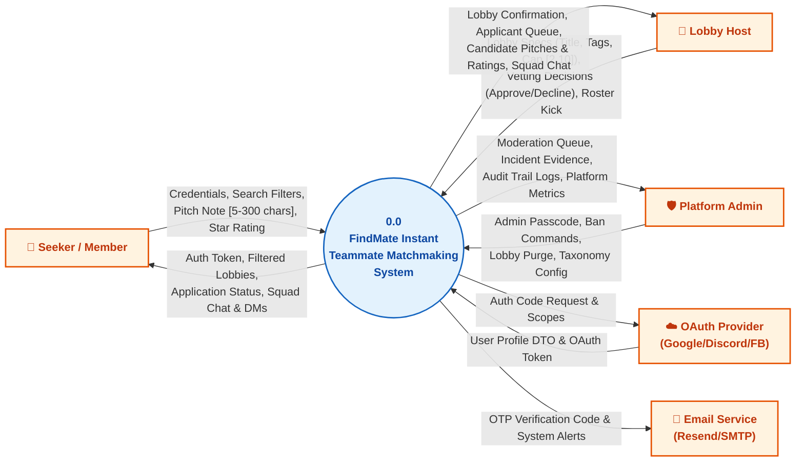
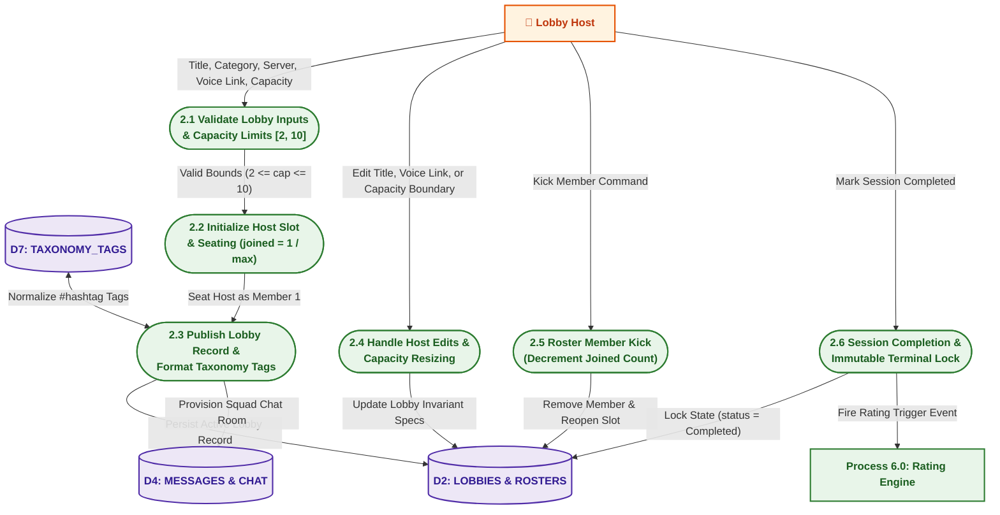
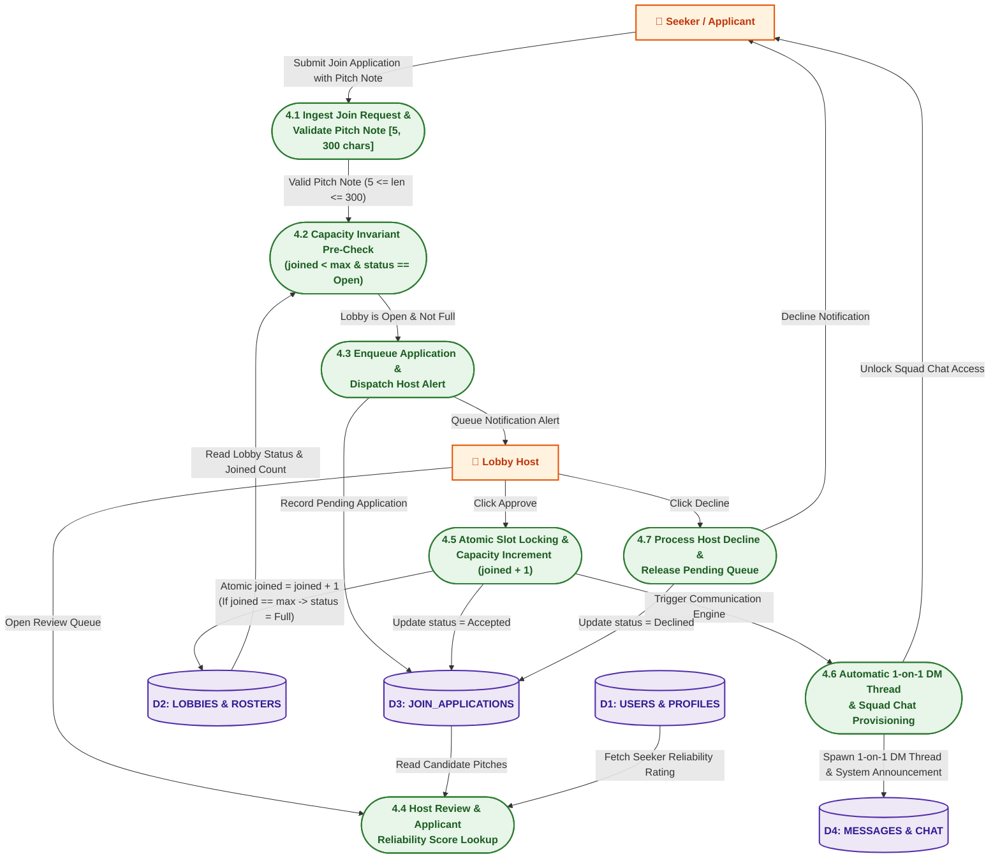

# FindMate — Data Flow Diagrams (DFD)

**Project**: FindMate — Instant Teammate Matchmaking Platform  
**Course**: CSE0613316 — Software Project Design and Development (Lab)  
**Supervisor / Instructor**: Al Imtiaz  
**Authors**: Abu Nasim (0432320005101033 / 211014022) & Rimon Chandra Bhowmik (0432320005101001 / 211014035)  
**Standard**: Gane & Sarson / Yourdon & DeMarco Structured Analysis Notation  
**Associated .drawio Directory**: [`docs/Diagrams/DFD Diagram/`](file:///home/user/Nasim/vs/Findmate/docs/Diagrams/DFD%20Diagram/)

---

## 1. DFD Architecture & Notation Guide

A **Data Flow Diagram (DFD)** models the flow of information through the system, capturing how external entities supply inputs, how automated processes transform data, where persistent records are stored, and how outputs are dispatched.

### DFD Notation Standard (Gane & Sarson / Yourdon):

| DFD Element | Symbol / Shape | Role in FindMate | Examples |
| :--- | :--- | :--- | :--- |
| **External Entity** | Square / Double Rectangle (`[Entity]`) | External actors or third-party systems that originate or receive data. | `Seeker`, `Lobby Host`, `Platform Admin`, `OAuth Provider` |
| **Process** | Rounded Rectangle / Circle (`((P))` or `[P]`) | Business logic units that transform incoming data packets into outgoing data. | `1.0 Authentication`, `2.0 Lobby Lifecycle`, `4.0 Vetting Engine` |
| **Data Store** | Open-Ended Rectangle (`[| Store |]`) | Persistent storage tables / repositories holding system records. | `D1: USERS`, `D2: LOBBIES`, `D3: APPLICATIONS`, `D4: MESSAGES` |
| **Data Flow** | Directed Vector (`-->|label|`) | Named data pipelines indicating movement of discrete data structures. | `Pitch Note`, `Auth Session Token`, `Slot Increment Command` |

---

## 2. Level 0: System Context Diagram

The **Context Diagram (Level 0)** establishes the platform scope boundary. It models the entire FindMate system as a single central process interacting with external actors.

### Mermaid Visualization: Level 0 Context Diagram



---

## 3. Level 1: System-Wide Functional Decomposition DFD

**Level 1 DFD** decomposes the single central process into the **7 core functional subsystems** of the platform, showing bidirectional interactions between external entities, business processes, and the **7 primary data stores**.

### Core Functional Subsystems (Processes):
- **1.0 Authentication & User Identity Management**: Handles sign-up, password complexity ($\ge 4$ chars), RFC email validation, case-insensitive handle uniqueness, and OAuth 2.0 social authorization.
- **2.0 Lobby Creation & Lifecycle Execution**: Enforces capacity boundaries ($2 \le \text{capacity} \le 10$), seats the host as member 1 (`joined = 1 / max`), associates taxonomy tags, and handles dynamic editing and completion triggers.
- **3.0 Matchmaking Discovery & Feed Ranking**: Filters live lobbies, excludes Closed and Completed rooms, matches user taxonomy tags, and ranks Admin-pinned rooms.
- **4.0 Application Vetting & Capacity Guard**: Ingests join applications with pitch notes ($5 \le \text{length} \le 300$ chars), guards capacity limits, issues host notifications, and executes atomic slot locking.
- **5.0 Real-Time Messaging & Direct Communication**: Provisions dedicated squad group chats for approved rosters and spawns automatic 1-on-1 DM threads between host and accepted seekers.
- **6.0 Teammate Reliability & Rating Processing**: Calculates weighted averages rounded to 1 decimal place (defaulting to 5.0 for fresh accounts) and tracks star distributions.
- **7.0 Moderation Triage & Platform Governance**: Admin incident review, user account banning (`isBanned = true`), infringing lobby purging, and audit logging.

### Mermaid Visualization: Level 1 DFD

```mermaid
flowchart TB
    %% External Entities
    subgraph ENTITIES [" EXTERNAL ENTITIES "]
        E1["👤 Seeker / Member"]
        E2["👑 Lobby Host"]
        E3["🛡️ Platform Admin"]
        E4["☁️ OAuth Provider"]
    end

    %% Processes
    subgraph PROCESSES [" LEVEL 1 CORE PROCESSES "]
        P1(["1.0 Authentication &<br/>Identity Management"])
        P2(["2.0 Lobby Creation &<br/>Lifecycle Management"])
        P3(["3.0 Matchmaking Discovery<br/>& Feed Ranking"])
        P4(["4.0 Application Vetting &<br/>Capacity Guard"])
        P5(["5.0 Real-Time Messaging<br/>& Chat Communication"])
        P6(["6.0 Teammate Reliability &<br/>Rating Calculation"])
        P7(["7.0 Moderation Triage &<br/>Platform Governance"])
    end

    %% Data Stores
    subgraph STORES [" DATA STORES "]
        D1[("D1: USERS & SESSIONS")]
        D2[("D2: LOBBIES & ROSTERS")]
        D3[("D3: JOIN_APPLICATIONS")]
        D4[("D4: MESSAGES & CHAT")]
        D5[("D5: TEAMMATE_RATINGS")]
        D6[("D6: REPORTS & AUDIT_LOGS")]
        D7[("D7: TAXONOMY_TAGS")]
    end

    %% Process 1.0 Flows
    E1 -->|"Credentials / Sign Up"| P1
    E4 -->|"OAuth Token & Profile"| P1
    P1 <-->|"Store & Verify User / Session"| D1
    P1 -->|"JWT / Session Token"| E1

    %% Process 2.0 Flows
    E2 -->|"Lobby Specs (Title, Cap [2,10])"| P2
    P2 <-->|"Format & Read Hashtags"| D7
    P2 -->|"Create Lobby & Seat Host (1/max)"| D2
    P2 -->|"Lobby Created Confirmation"| E2

    %% Process 3.0 Flows
    E1 -->|"Search Query & Category Tab"| P3
    D2 -->|"Read Active Open Lobbies"| P3
    D7 -->|"Read Tag Taxonomy"| P3
    P3 -->|"Ranked Lobby Cards"| E1

    %% Process 4.0 Flows
    E1 -->|"Pitch Note [5-300 chars]"| P4
    D2 <-->|"Pre-check Capacity & Lock Slot"| P4
    P4 -->|"Store Application (Pending)"| D3
    P4 -->|"Queue Alert"| E2
    E2 -->|"Approve / Decline Decision"| P4
    P4 -->|"Update App (Accepted/Declined)"| D3
    P4 -->|"Trigger Auto-DM & Chat Unlock"| P5

    %% Process 5.0 Flows
    E1 <-->|"Squad Chat & 1-on-1 DMs"| P5
    E2 <-->|"Squad Chat & Host DMs"| P5
    P5 <-->|"Persist Messages & Badges"| D4

    %% Process 6.0 Flows
    P2 -->|"Lobby Completed Event"| P6
    E1 -->|"Teammate Star Rating (1-5)"| P6
    P6 -->|"Store Review Record"| D5
    P6 -->|"Update User Reliability Score"| D1

    %% Process 7.0 Flows
    E1 -->|"File Incident Report"| P7
    P7 -->|"Store Violation Report"| D6
    E3 -->|"Admin Passcode & Ban Action"| P7
    P7 -->|"Toggle isBanned=true"| D1
    P7 -->|"Delete Infringing Lobby"| D2
    P7 -->|"Write Audit Log"| D6

    %% Styling
    classDef entity fill:#FFF3E0,stroke:#E65100,stroke-width:2px,color:#BF360C,font-weight:bold;
    classDef process fill:#E8F5E9,stroke:#2E7D32,stroke-width:2px,color:#1B5E20,font-weight:bold;
    classDef store fill:#EDE7F6,stroke:#512DA8,stroke-width:2px,color:#311B92,font-weight:bold;
    class E1,E2,E3,E4 entity;
    class P1,P2,P3,P4,P5,P6,P7 process;
    class D1,D2,D3,D4,D5,D6,D7 store;
```



---

## 4. Level 2: Detailed Subsystem Decompositions

To provide deep academic rigor, **Level 2 DFDs** decompose the two most critical architectural pipelines in FindMate:
1. **Process 2.0 (Lobby Lifecycle & Capacity Management)**
2. **Process 4.0 (Application Vetting & Matchmaking Engine)**

---

### Level 2 DFD: Process 2.0 (Lobby Lifecycle & Capacity Management)

Decomposes Process 2.0 into 6 discrete, boundary-verified sub-processes matching requirements **FR-17 through FR-23** and **FR-37 through FR-40**:



---

### Level 2 DFD: Process 4.0 (Application Vetting & Matchmaking Engine)

Decomposes Process 4.0 into 7 sub-processes modeling the core team-up engine, pitch validation, atomic capacity guarding, and automated direct messaging spawn matching requirements **FR-30 through FR-36** and **FR-42**:



---

## 5. Comprehensive Data Dictionary

### Data Stores (Persistent Repositories)

| Store ID | Store Name | Primary Key | Key Attributes / Schema | Storage Technology |
| :--- | :--- | :--- | :--- | :--- |
| **D1** | `USERS & SESSIONS` | `id` (`u1`, `u2`) | `handle`, `email`, `password_hash`, `role` (`admin`/`user`), `reliability_score` (default 5.0), `is_banned`, `tags` | PostgreSQL 16 (`users` table) / LocalStorage Adapter |
| **D2** | `LOBBIES & ROSTERS` | `id` (`lob_*`) | `title`, `category`, `host_id`, `joined`, `max` $[2, 10]$, `status` (`Open`, `Full`, `Completed`, `Closed`), `members[]` | PostgreSQL 16 (`lobbies` table) |
| **D3** | `JOIN_APPLICATIONS`| `id` (`app_*`) | `lobby_id`, `user_id`, `pitch` $[5, 300\text{ chars}]$, `status` (`Pending`, `Accepted`, `Declined`), `created_at` | PostgreSQL 16 (`join_requests` table) |
| **D4** | `MESSAGES & THREADS`| `id` (`msg_*`) | `thread_id` (or `lobby_id`), `sender_id`, `content`, `type` (`chat`, `dm`, `broadcast`), `timestamp`, `read_by[]` | PostgreSQL 16 (`messages` table) |
| **D5** | `TEAMMATE_RATINGS` | `id` (`rat_*`) | `evaluator_id`, `target_user_id`, `lobby_id`, `stars` $[1, 5]$, `comment`, `created_at` | PostgreSQL 16 (`ratings` table) |
| **D6** | `REPORTS & AUDITS`  | `id` (`rep_*`) | `target_type` (`user`/`lobby`), `target_id`, `reporter_id`, `reason`, `status` (`Pending`, `Resolved`), `admin_audit_note` | PostgreSQL 16 (`reports` table) |
| **D7** | `TAXONOMY_TAGS`    | `id` (`tag_*`) | `name` (`#valorant`, `#react`), `category`, `usage_count`, `created_at` | PostgreSQL 16 / Static Taxonomy Catalog |

---

## 6. Where the Diagrams are Stored & How to Open Them

All diagram files are organized in the project repository:

```text
docs/Diagrams/
├── DFD Diagram/
│   ├── DFD Context Level 0.drawio     # Context Level 0 diagram
│   ├── DFD Level 1.drawio             # Full system-wide Level 1 DFD
│   └── DFD Level 2.drawio             # Multi-tab Level 2 DFD (Process 2.0 & 4.0)
├── Sequence Diagram/
│   ├── ... (.drawio files)
├── Usecase Diagram/
│   ├── ... (.drawio files)
├── ER Diagram.drawio
├── ER_Diagram.md
├── Sequence_Diagram.md
└── DFD_Diagram.md                     # This documentation file
```

### How to Open & Edit in Draw.io / Diagrams.net:
1. **Online**: Navigate to [https://app.diagrams.net/](https://app.diagrams.net/) $\rightarrow$ Click **"Open Existing Diagram"** $\rightarrow$ Select any `.drawio` file from `docs/Diagrams/DFD Diagram/`.
2. **VS Code Extension**: Install the **"Draw.io Integration"** extension (by Henning Dieterichs) in VS Code $\rightarrow$ Simply click on any `.drawio` file to open the interactive visual editor directly in your IDE.
3. **Exporting as PNG / PDF**: In diagrams.net, click **File $\rightarrow$ Export as $\rightarrow$ PNG / PDF** with 300 DPI transparent background for inclusion in lab reports or final presentation slides.
