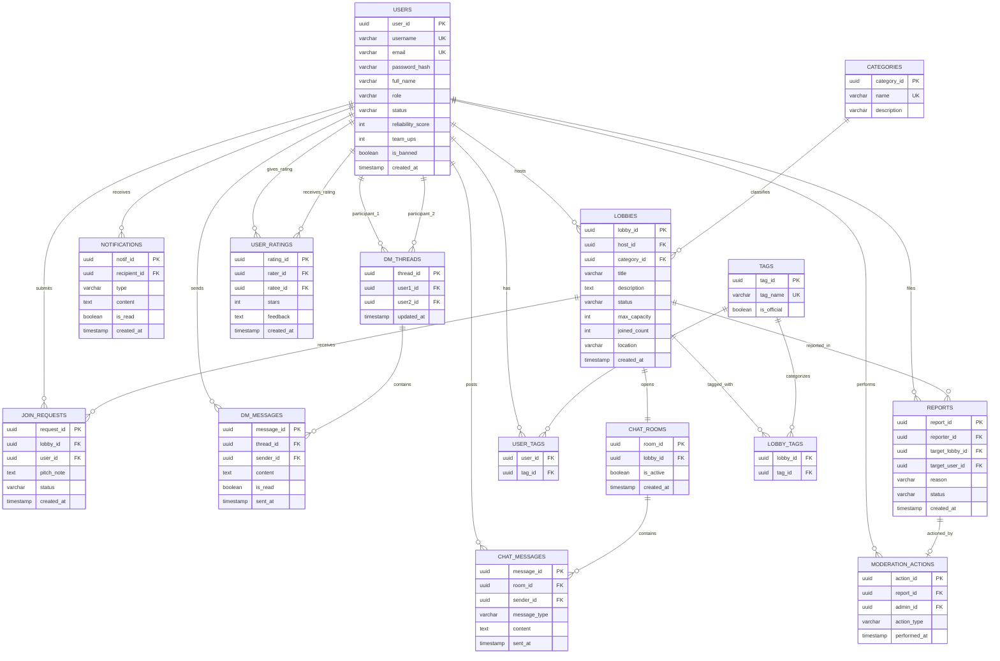

# FindMate — Entity-Relationship (ER) Diagrams

This document contains the verified, standard dual-model database specification for **FindMate**:

1. **Chen's Conceptual Entity-Relationship Model (Figure 3.5)**: Employs formal Chen notation using Rectangles for Entities, Diamonds for Relationships, Ellipses for Attributes, Underlined text for Primary Keys, and explicit Cardinalities (`1:1`, `1:M`, `M:N`) organized into clean functional domain subgraphs.
2. **Relational Crow's Foot Database Schema (Figure 3.6)**: Native Mermaid relational database diagram specifying tables, PostgreSQL column types, Primary Keys (`PK`), Foreign Keys (`FK`), Unique Keys (`UK`), and referential integrity constraints.

---

## 1. Chen's Conceptual Entity-Relationship Diagram (Figure 3.5)

```mermaid
flowchart TD
    %% ==========================================
    %% GLOBAL STYLING (Chen's ER Formal Standard)
    %% ==========================================
    classDef entity fill:#1E293B,stroke:#38BDF8,stroke-width:2px,color:#F8FAFC,font-weight:bold,font-size:13px;
    classDef relation fill:#312E81,stroke:#818CF8,stroke-width:2px,color:#EEF2FF,font-weight:bold,font-size:11px;
    classDef attr fill:#0F172A,stroke:#64748B,stroke-width:1px,color:#E2E8F0,font-size:10px;
    classDef keyAttr fill:#0F172A,stroke:#F59E0B,stroke-width:1.5px,color:#FDE68A,font-weight:bold,font-size:10px;

    %% ==========================================
    %% ENTITY MODULES & CHEN ATTRIBUTES
    %% ==========================================

    subgraph SG_USER [" USER DOMAIN MODULE "]
        direction TB
        E_USER["USER"]:::entity
        A_U1(["user_id (PK)"]):::keyAttr
        A_U2(["username"]):::attr
        A_U3(["email"]):::attr
        A_U4(["role"]):::attr
        A_U5(["reliability_score"]):::attr
        A_U6(["is_banned"]):::attr
        E_USER --- A_U1
        E_USER --- A_U2
        E_USER --- A_U3
        E_USER --- A_U4
        E_USER --- A_U5
        E_USER --- A_U6
    end

    subgraph SG_LOBBY [" LOBBY DOMAIN MODULE "]
        direction TB
        E_LOBBY["LOBBY"]:::entity
        A_L1(["lobby_id (PK)"]):::keyAttr
        A_L2(["title"]):::attr
        A_L3(["description"]):::attr
        A_L4(["status"]):::attr
        A_L5(["max_capacity"]):::attr
        A_L6(["location"]):::attr
        E_LOBBY --- A_L1
        E_LOBBY --- A_L2
        E_LOBBY --- A_L3
        E_LOBBY --- A_L4
        E_LOBBY --- A_L5
        E_LOBBY --- A_L6
    end

    subgraph SG_TAXONOMY [" TAXONOMY MODULE "]
        direction TB
        E_CAT["CATEGORY"]:::entity
        A_C1(["category_id (PK)"]):::keyAttr
        A_C2(["name"]):::attr
        A_C3(["description"]):::attr
        E_CAT --- A_C1
        E_CAT --- A_C2
        E_CAT --- A_C3

        E_TAG["TAG"]:::entity
        A_T1(["tag_id (PK)"]):::keyAttr
        A_T2(["tag_name"]):::attr
        A_T3(["is_official"]):::attr
        E_TAG --- A_T1
        E_TAG --- A_T2
        E_TAG --- A_T3
    end

    subgraph SG_REQ [" PITCH & APPLICATION MODULE "]
        direction TB
        E_REQ["JOIN_REQUEST"]:::entity
        A_R1(["request_id (PK)"]):::keyAttr
        A_R2(["pitch_note"]):::attr
        A_R3(["status"]):::attr
        A_R4(["created_at"]):::attr
        E_REQ --- A_R1
        E_REQ --- A_R2
        E_REQ --- A_R3
        E_REQ --- A_R4
    end

    subgraph SG_CHAT [" SQUAD GROUP CHAT MODULE "]
        direction TB
        E_ROOM["CHAT_ROOM"]:::entity
        A_CR1(["room_id (PK)"]):::keyAttr
        A_CR2(["is_active"]):::attr
        E_ROOM --- A_CR1
        E_ROOM --- A_CR2

        E_MSG["CHAT_MESSAGE"]:::entity
        A_M1(["message_id (PK)"]):::keyAttr
        A_M2(["content"]):::attr
        A_M3(["message_type"]):::attr
        A_M4(["sent_at"]):::attr
        E_MSG --- A_M1
        E_MSG --- A_M2
        E_MSG --- A_M3
        E_MSG --- A_M4
    end

    subgraph SG_DM [" DIRECT MESSAGING (DM) MODULE "]
        direction TB
        E_DM_TH["DM_THREAD"]:::entity
        A_DMT1(["thread_id (PK)"]):::keyAttr
        A_DMT2(["updated_at"]):::attr
        E_DM_TH --- A_DMT1
        E_DM_TH --- A_DMT2

        E_DM_MSG["DM_MESSAGE"]:::entity
        A_DMM1(["message_id (PK)"]):::keyAttr
        A_DMM2(["content"]):::attr
        A_DMM3(["is_read"]):::attr
        A_DMM4(["sent_at"]):::attr
        E_DM_MSG --- A_DMM1
        E_DM_MSG --- A_DMM2
        E_DM_MSG --- A_DMM3
        E_DM_MSG --- A_DMM4
    end

    subgraph SG_MOD [" MODERATION & AUDIT MODULE "]
        direction TB
        E_REPORT["REPORT"]:::entity
        A_RP1(["report_id (PK)"]):::keyAttr
        A_RP2(["reason"]):::attr
        A_RP3(["status"]):::attr
        A_RP4(["created_at"]):::attr
        E_REPORT --- A_RP1
        E_REPORT --- A_RP2
        E_REPORT --- A_RP3
        E_REPORT --- A_RP4

        E_MOD["MODERATION_ACTION"]:::entity
        A_MD1(["action_id (PK)"]):::keyAttr
        A_MD2(["action_type"]):::attr
        A_MD3(["performed_at"]):::attr
        E_MOD --- A_MD1
        E_MOD --- A_MD2
        E_MOD --- A_MD3
    end

    subgraph SG_RATING [" REPUTATION & RATING MODULE "]
        direction TB
        E_RATING["USER_RATING"]:::entity
        A_RT1(["rating_id (PK)"]):::keyAttr
        A_RT2(["stars"]):::attr
        A_RT3(["feedback"]):::attr
        A_RT4(["created_at"]):::attr
        E_RATING --- A_RT1
        E_RATING --- A_RT2
        E_RATING --- A_RT3
        E_RATING --- A_RT4
    end

    %% ==========================================
    %% CHEN RELATIONSHIPS (DIAMONDS)
    %% ==========================================
    R_CREATES{"creates"}:::relation
    R_CLASSIFIED{"classified_as"}:::relation
    R_TAGGED{"tagged_with"}:::relation
    R_SELECTS{"selects"}:::relation
    R_SUBMITS{"submits"}:::relation
    R_RECEIVES{"receives"}:::relation
    R_OPENS{"opens"}:::relation
    R_CONTAINS{"contains"}:::relation
    R_POSTS{"posts"}:::relation
    R_INITIATES{"initiates"}:::relation
    R_INCLUDES{"includes"}:::relation
    R_SENDS{"sends"}:::relation
    R_FILES{"files"}:::relation
    R_TARGETS{"targets"}:::relation
    R_PERFORMS{"performs"}:::relation
    R_RESOLVES{"resolves"}:::relation
    R_RATES{"rates"}:::relation
    R_RECEIVES_RATING{"rated_in"}:::relation

    %% ==========================================
    %% CARDINALITY CONNECTORS
    %% ==========================================
    %% Host & Lobby
    E_USER ---|"1"| R_CREATES
    R_CREATES ---|"M"| E_LOBBY

    %% Lobby & Category
    E_LOBBY ---|"M"| R_CLASSIFIED
    R_CLASSIFIED ---|"1"| E_CAT

    %% Tags (M:N)
    E_LOBBY ---|"M"| R_TAGGED
    R_TAGGED ---|"N"| E_TAG

    E_USER ---|"M"| R_SELECTS
    R_SELECTS ---|"N"| E_TAG

    %% Join Requests (1:M)
    E_USER ---|"1"| R_SUBMITS
    R_SUBMITS ---|"M"| E_REQ

    E_LOBBY ---|"1"| R_RECEIVES
    R_RECEIVES ---|"M"| E_REQ

    %% Squad Group Chat (1:1 & 1:M)
    E_LOBBY ---|"1"| R_OPENS
    R_OPENS ---|"1"| E_ROOM

    E_ROOM ---|"1"| R_CONTAINS
    R_CONTAINS ---|"M"| E_MSG

    E_USER ---|"1"| R_POSTS
    R_POSTS ---|"M"| E_MSG

    %% Direct Messaging (1:M)
    E_USER ---|"1"| R_INITIATES
    R_INITIATES ---|"M"| E_DM_TH

    E_DM_TH ---|"1"| R_INCLUDES
    R_INCLUDES ---|"M"| E_DM_MSG

    E_USER ---|"1"| R_SENDS
    R_SENDS ---|"M"| E_DM_MSG

    %% Moderation & Audit (1:M & 1:1)
    E_USER ---|"1"| R_FILES
    R_FILES ---|"M"| E_REPORT

    E_REPORT ---|"M"| R_TARGETS
    R_TARGETS ---|"1"| E_LOBBY

    E_USER ---|"1"| R_PERFORMS
    R_PERFORMS ---|"M"| E_MOD

    E_MOD ---|"1"| R_RESOLVES
    R_RESOLVES ---|"1"| E_REPORT

    %% Peer Reviews & Ratings (1:M)
    E_USER ---|"1"| R_RATES
    R_RATES ---|"M"| E_RATING

    E_RATING ---|"M"| R_RECEIVES_RATING
    R_RECEIVES_RATING ---|"1"| E_USER
```

---

## 2. Relational Crow's Foot Database Schema (Figure 3.6)

---

## 3. Comprehensive Relationship & Cardinality Reference

| Relationship (Diamond) | Source Entity $
ightarrow$ Target Entity | Cardinality | Business Semantics & Referential Constraints |
| :--- | :--- | :---: | :--- |
| **`creates`** | `USER` (Host) $
ightarrow$ `LOBBY` | **1 : M** | One user can create and manage multiple ad-hoc micro-lobbies. |
| **`classified_as`** | `LOBBY` $
ightarrow$ `CATEGORY` | **M : 1** | Multiple lobbies belong to exactly one activity category (Gaming, Coding, Sports, Study). |
| **`tagged_with`** | `LOBBY` $
ightarrow$ `TAG` | **M : N** | Resolved physically via `LOBBY_TAGS` associative table with composite primary key `(lobby_id, tag_id)`. |
| **`selects`** | `USER` $
ightarrow$ `TAG` | **M : N** | Resolved physically via `USER_TAGS` associative table with composite primary key `(user_id, tag_id)`. |
| **`submits`** | `USER` (Applicant) $
ightarrow$ `JOIN_REQUEST` | **1 : M** | One user submits multiple join requests accompanied by custom pitch notes. |
| **`receives`** | `LOBBY` $
ightarrow$ `JOIN_REQUEST` | **1 : M** | One lobby receives multiple applicant join requests (`pending`, `accepted`, `declined`). |
| **`opens`** | `LOBBY` $
ightarrow$ `CHAT_ROOM` | **1 : 1** | Each active lobby provisions exactly one dedicated group squad chat room (`ON DELETE CASCADE`). |
| **`contains`** | `CHAT_ROOM` $
ightarrow$ `CHAT_MESSAGE` | **1 : M** | One chat room contains an ordered chronological log of text and system broadcast messages. |
| **`posts`** | `USER` $
ightarrow$ `CHAT_MESSAGE` | **1 : M** | One authenticated squad member posts multiple messages within the lobby chat room. |
| **`initiates`** | `USER` $
ightarrow$ `DM_THREAD` | **1 : M** | One user initiates 1-on-1 private direct messaging channels with prospective or accepted teammates. |
| **`includes`** | `DM_THREAD` $
ightarrow$ `DM_MESSAGE` | **1 : M** | One direct messaging thread contains an ordered dialogue history between two participants. |
| **`sends`** | `USER` $
ightarrow$ `DM_MESSAGE` | **1 : M** | One user sends multiple direct messages with delivery receipts and unread tracking. |
| **`files`** | `USER` $
ightarrow$ `REPORT` | **1 : M** | Any registered community member can file moderation incident reports against abusive users or spam lobbies. |
| **`targets`** | `REPORT` $
ightarrow$ `LOBBY` | **M : 1** | Multiple incident reports can target the same reported lobby entity. |
| **`performs`** | `USER` (Admin) $
ightarrow$ `MODERATION_ACTION` | **1 : M** | An authorized Administrator executes audit-trailed moderation actions (`delete_lobby`, `ban_user`, `dismiss`). |
| **`resolves`** | `MODERATION_ACTION` $
ightarrow$ `REPORT` | **1 : 1** | One administrative moderation action resolves the flagged incident report. |
| **`rates`** | `USER` (Rater) $
ightarrow$ `USER_RATING` | **1 : M** | After lobby completion, teammates submit star ratings (1-5) and written feedback for each other. |
| **`rated_in`** | `USER_RATING` $
ightarrow$ `USER` (Ratee) | **M : 1** | Multiple teammate reviews aggregate dynamically to compute the user's `reliability_score` percentage. |

---

## 4. Entity Attribute Dictionary

### 4.1 `USERS` (Master Identity & Reputation)
* `user_id` (UUID, Primary Key): Unique surrogate identifier for the user account.
* `username` (VARCHAR(50), Unique, Not Null): Alphanumeric community handle (e.g., `@Error-nasim`).
* `email` (VARCHAR(255), Unique, Not Null): Verified electronic mail address.
* `password_hash` (VARCHAR(255), Not Null): Argon2id / bcrypt salted cryptographic password digest.
* `full_name` (VARCHAR(100), Not Null): User's real or display name.
* `role` (VARCHAR(20), Not Null, Default `'member'`): Access role (`'member'`, `'admin'`).
* `status` (VARCHAR(20), Default `'active'`): Account operational state (`'active'`, `'suspended'`).
* `reliability_score` (INT, Default 100): Calculated reliability rating (0–100%) based on completed lobbies and peer ratings.
* `team_ups` (INT, Default 0): Total count of successfully completed cooperative sessions.
* `is_banned` (BOOLEAN, Default FALSE): Administrative ban status flag enforcing immediate RBAC denial.
* `created_at` (TIMESTAMP WITH TIME ZONE, Default `NOW()`): UTC account registration timestamp.

### 4.2 `LOBBIES` (Micro-Lobby Activity Hub)
* `lobby_id` (UUID, Primary Key): Unique identifier for the micro-lobby.
* `host_id` (UUID, Foreign Key $
ightarrow$ `USERS.user_id`, On Delete Cascade): User account that provisioned the lobby.
* `category_id` (UUID, Foreign Key $
ightarrow$ `CATEGORIES.category_id`, On Delete Restrict): Primary activity genre.
* `title` (VARCHAR(150), Not Null): Human-readable session title (e.g., "Valorant Ranked Push — Diamond to Immortal").
* `description` (TEXT, Not Null): Detailed briefing outlining prerequisites, role composition, and scheduling goals.
* `status` (VARCHAR(20), Default `'Open'`): Lifecycle state (`'Open'`, `'Full'`, `'In-Progress'`, `'Completed'`, `'Closed'`).
* `max_capacity` (INT, Not Null): Maximum permissible team size (bounded by business rules $2 \le N \le 10$).
* `joined_count` (INT, Default 1): Current count of accepted squad members including the host.
* `location` (VARCHAR(100), Default `'Online'`): Virtual or physical coordinate (e.g., `'Discord'`, `'Campus Lab 4'`).
* `created_at` (TIMESTAMP WITH TIME ZONE, Default `NOW()`): Creation timestamp.

### 4.3 `CATEGORIES` & `TAGS` (Taxonomy & Matchmaking)
* `category_id` (UUID, Primary Key): Unique taxonomy category identifier.
* `name` (VARCHAR(50), Unique, Not Null): Activity genre name (`'Gaming'`, `'Coding'`, `'Sports'`, `'Study'`, `'Fitness'`).
* `description` (VARCHAR(255)): Scope and descriptive guidance for the category.
* `tag_id` (UUID, Primary Key): Unique topic tag identifier.
* `tag_name` (VARCHAR(50), Unique, Not Null): Normalized hashtag (e.g., `'#valorant'`, `'#hackathon'`, `'#leetcode'`).
* `is_official` (BOOLEAN, Default TRUE): System-verified tag indicator.

### 4.4 `JOIN_REQUESTS` (Application Pitch Vetting Engine)
* `request_id` (UUID, Primary Key): Unique applicant pitch identifier.
* `lobby_id` (UUID, Foreign Key $
ightarrow$ `LOBBIES.lobby_id`, On Delete Cascade): Target lobby.
* `user_id` (UUID, Foreign Key $
ightarrow$ `USERS.user_id`, On Delete Cascade): Applying seeker.
* `pitch_note` (TEXT, Not Null): Structured introduction note explaining applicant role, availability, and rank.
* `status` (VARCHAR(20), Default `'pending'`): Evaluation status (`'pending'`, `'accepted'`, `'declined'`).
* `created_at` (TIMESTAMP WITH TIME ZONE, Default `NOW()`): Submission timestamp.

### 4.5 `CHAT_ROOMS` & `CHAT_MESSAGES` (Squad Collaboration)
* `room_id` (UUID, Primary Key): Unique chat channel identifier linked 1:1 to a lobby.
* `lobby_id` (UUID, Foreign Key $
ightarrow$ `LOBBIES.lobby_id`, On Delete Cascade): Associated lobby.
* `is_active` (BOOLEAN, Default TRUE): Active status flag.
* `message_id` (UUID, Primary Key): Unique message identifier.
* `room_id` (UUID, Foreign Key $
ightarrow$ `CHAT_ROOMS.room_id`, On Delete Cascade): Parent chat room.
* `sender_id` (UUID, Foreign Key $
ightarrow$ `USERS.user_id`, On Delete Set Null): Message author.
* `message_type` (VARCHAR(20), Default `'user'`): Message classification (`'user'`, `'system'`).
* `content` (TEXT, Not Null): Message payload.
* `sent_at` (TIMESTAMP WITH TIME ZONE, Default `NOW()`): Transmission timestamp.

### 4.6 `DM_THREADS` & `DM_MESSAGES` (Direct Communication)
* `thread_id` (UUID, Primary Key): Unique bilateral conversation channel.
* `user1_id` (UUID, Foreign Key $
ightarrow$ `USERS.user_id`, On Delete Cascade): Participant 1.
* `user2_id` (UUID, Foreign Key $
ightarrow$ `USERS.user_id`, On Delete Cascade): Participant 2.
* `updated_at` (TIMESTAMP WITH TIME ZONE, Default `NOW()`): Timestamp of latest message exchange.
* `message_id` (UUID, Primary Key): Individual direct message identifier.
* `thread_id` (UUID, Foreign Key $
ightarrow$ `DM_THREADS.thread_id`, On Delete Cascade): Parent thread.
* `sender_id` (UUID, Foreign Key $
ightarrow$ `USERS.user_id`, On Delete Set Null): Transmitting participant.
* `content` (TEXT, Not Null): Message text.
* `is_read` (BOOLEAN, Default FALSE): Read acknowledgment indicator.
* `sent_at` (TIMESTAMP WITH TIME ZONE, Default `NOW()`): Timestamp.

### 4.7 `REPORTS` & `MODERATION_ACTIONS` (Security & RBAC Enforcement)
* `report_id` (UUID, Primary Key): Unique community incident report ticket.
* `reporter_id` (UUID, Foreign Key $
ightarrow$ `USERS.user_id`, On Delete Set Null): Reporting user.
* `target_lobby_id` (UUID, Foreign Key $
ightarrow$ `LOBBIES.lobby_id`, On Delete Set Null): Reported lobby (if applicable).
* `target_user_id` (UUID, Foreign Key $
ightarrow$ `USERS.user_id`, On Delete Set Null): Reported user (if applicable).
* `reason` (VARCHAR(255), Not Null): Incident classification (`'Spam'`, `'Harassment'`, `'Inappropriate Content'`).
* `status` (VARCHAR(20), Default `'pending'`): Workflow status (`'pending'`, `'resolved'`, `'dismissed'`).
* `created_at` (TIMESTAMP WITH TIME ZONE, Default `NOW()`): Filing timestamp.
* `action_id` (UUID, Primary Key): Administrative audit log record.
* `report_id` (UUID, Foreign Key $
ightarrow$ `REPORTS.report_id`, On Delete Set Null): Related incident ticket.
* `admin_id` (UUID, Foreign Key $
ightarrow$ `USERS.user_id`, On Delete Set Null): Enforcing administrator.
* `action_type` (VARCHAR(50), Not Null): Executed measure (`'delete_lobby'`, `'ban_user'`, `'dismiss'`).
* `performed_at` (TIMESTAMP WITH TIME ZONE, Default `NOW()`): Execution timestamp.

### 4.8 `USER_RATINGS` (Post-Session Peer Evaluation)
* `rating_id` (UUID, Primary Key): Unique peer review record.
* `rater_id` (UUID, Foreign Key $
ightarrow$ `USERS.user_id`, On Delete Cascade): Member providing evaluation.
* `ratee_id` (UUID, Foreign Key $
ightarrow$ `USERS.user_id`, On Delete Cascade): Teammate being rated.
* `stars` (INT, Not Null): Score from 1 to 5 stars ($1 \le S \le 5$).
* `feedback` (TEXT): Qualitative written testimonial.
* `created_at` (TIMESTAMP WITH TIME ZONE, Default `NOW()`): Rating submission timestamp.
