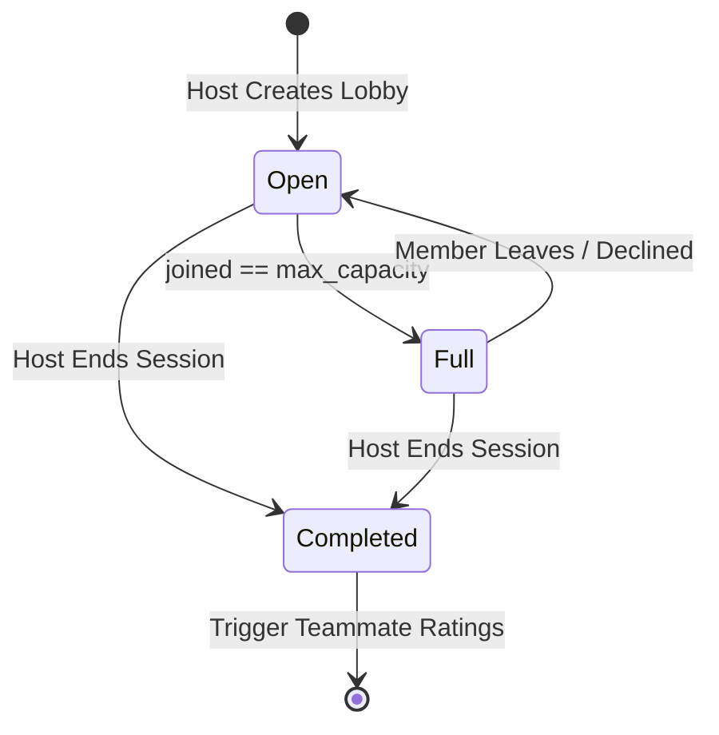

# CSE0613316 — Software Project Design and Development (Lab)
# SOFTWARE TEST REPORT
### Test Plan · Test Specification · Test Completion Report
**Tailored from ISO/IEC/IEEE 29119-3 & ISO/IEC 25010**

---

| Project Metadata | Detail |
| :--- | :--- |
| **Project Title** | **FindMate — Instant Teammate Matchmaking Platform** |
| **Team ID** | **Team 04** |
| **Member 1 (Test Lead & Developer)** | **Abu Nasim** (ID: 211014022) — Test lead, architecture, frontend & integration testing |
| **Member 2 (Reviewer & Developer)** | **Rimon Chandra Bhowmik** (ID: 211014035) — Backend testing, test data generation, documentation review |
| **Supervisor / Instructor** | **Al Imtiaz** |
| **Course** | **CSE0613316 — Software Project Design and Development (Lab)** |
| **Department / University** | Department of Computer Science & Engineering, **University of Information Technology and Sciences (UITS)**, Dhaka |
| **Experiment Phase** | ☑ **Exp 9 (v1.0)** &nbsp;&nbsp;&nbsp;&nbsp; ☑ **Exp 10 (v1.1)** |
| **Date of Submission** | **October 26, 2026** |

---

## Document Control

| Parameter | Value |
| :--- | :--- |
| **Repository URL** | `https://github.com/Error-nasim/Findmate` |
| **Version Tested (Commit SHA / Tag)** | Tag: `v1.0-release` (Commit: `791f8e5`) |
| **Test Environment URL** | `http://localhost:5173` (Frontend) & `http://localhost:8080/api` (Backend) |
| **Report Version** | `1.1` (Unified Exp 9 Test Completion + Exp 10 Security & Static Analysis) |
| **Prepared By** | Abu Nasim (Test Lead) |
| **Reviewed By** | Rimon Chandra Bhowmik (Peer Reviewer) |
| **Target Tier Declared** | ☐ Baseline &nbsp;&nbsp;&nbsp;&nbsp; ☐ Professional &nbsp;&nbsp;&nbsp;&nbsp; ☑ **Distinction (Aiming for Grade Band 4)** |

### Revision History

| Version | Date | Author | Changes & Additions |
| :--- | :--- | :--- | :--- |
| **1.0** | Oct 23, 2026 | Abu Nasim | Initial test plan, RTM, Unit, Integration, and E2E suites for Exp 9 |
| **1.1** | Oct 26, 2026 | Rimon Chandra Bhowmik | Added OWASP ZAP security audit, k6 performance metrics, SonarCloud static analysis, and mutation testing for Exp 10 |

---

## 1. Introduction

### 1.1 Purpose
This document provides the complete, industry-standard **Software Test Report** for **FindMate** at version `v1.0-release`. It encompasses the end-to-end verification and validation lifecycle tailored from **ISO/IEC/IEEE 29119-3**, detailing test planning, test case specification (using Equivalence Partitioning, Boundary Value Analysis, State Transition, and Decision Tables), continuous integration results, automated code coverage, non-functional quality characteristics (**ISO/IEC 25010**), defect lifecycle tracking, and release sign-off.

### 1.2 Product Overview
**FindMate** is an instant team-up and matchmaking platform designed for competitive gamers, hackathon developers, pickup sports athletes, and study squads. It replaces rigid calendar invites and noisy Discord channels with a lobby-first micro-architecture: hosts publish capacity-constrained rooms, applicants submit tailored pitch notes with reliability metrics, and the platform provisions dedicated squad chat rooms, 1-on-1 direct messaging, and dynamic teammate ratings. The frontend is built on **React 19**, **Vite 6**, and **Tailwind CSS 3**, backed by a high-concurrency **Go 1.22+ Gin** REST API and PostgreSQL database.

### 1.3 Scope of Testing

#### In-Scope Modules

| Feature / Module | Requirement IDs | Test Levels Applied | Description |
| :--- | :--- | :--- | :--- |
| **User Authentication & Profiles** | FR-01, NFR-02 | Unit, Integration, E2E, Security | Login, session persistence, profile edits, linked accounts, dynamic star ratings (`calculateUserRating`) |
| **Lobby Discovery & Filtering** | FR-02, FR-03 | Unit, Integration, E2E | Keyword search, domain categories, topic hashtag filters, match compatibility score calculation |
| **Lobby Management & Lifecycle** | FR-02, FR-05 | Unit, Integration, State Transition | Lobby creation, capacity limits $[2, 10]$, state transitions (`Open` $\rightarrow$ `Full` $\rightarrow$ `Completed`) |
| **Application & Host Vetting Engine** | FR-04, FR-05 | Integration, E2E, BVA | Pitch note validation $[5, 300\text{ chars}]$, host approval, slot locking, system announcements, auto-DM spawn |
| **Squad Group Chat & 1-on-1 DMs** | FR-06 | Integration, E2E, UI | Ephemeral squad chat room, direct messaging threads, unread counter badges |
| **Admin Control Center (`/admin`)** | FR-07, NFR-02 | Integration, Security (RBAC) | Moderation queue triage, user ban/unban toggles, lobby purge, tag taxonomy, audit trail logging |
| **Performance & Accessibility** | NFR-01, NFR-03 | Performance, Accessibility | k6 load testing (20 VUs, p95 $< 500\text{ ms}$), Lighthouse WCAG 2.2 AA score $\ge 90$ |

#### Out-of-Scope Items

| Feature / Item | Reason Not Tested Internally |
| :--- | :--- |
| **Third-Party Discord/OAuth Server Internals** | Owned by third-party providers (Discord / Google); verified via mocked OAuth redirect payloads and sandbox integration. |
| **Direct Hardware Camera / Mic Streams** | Platform manages digital link dispatch (Discord/Zoom URLs); audio/video codecs run in native external apps. |

### 1.4 References
1. **ISO/IEC/IEEE 29119-3:2021**: Software and systems engineering — Software testing — Part 3: Test documentation.
2. **ISO/IEC 25010:2011**: Systems and software engineering — Systems and software Quality Requirements and Evaluation (SQuaRE) — Product quality model.
3. **ISTQB® Foundation Level Syllabus v4.0**: Test Design Techniques (EP, BVA, Decision Tables, State Transitions).
4. **OWASP Application Security Verification Standard (ASVS)** v4.0.3 (Level 1 Checklist) & OWASP Top 10:2021.
5. **W3C Web Content Accessibility Guidelines (WCAG) 2.2**: Conformance Level AA.
6. **FindMate System Architecture & Sequence Diagrams**: [`Diagrams/Sequence_Diagram.md`](file:///home/user/Nasim/vs/Findmate/Diagrams/Sequence_Diagram.md) & [`Diagrams/ER_Diagram.md`](file:///home/user/Nasim/vs/Findmate/Diagrams/ER_Diagram.md).

### 1.5 Definitions and Abbreviations
- **RTM**: Requirements Traceability Matrix
- **EP**: Equivalence Partitioning
- **BVA**: Boundary Value Analysis
- **E2E**: End-to-End System Testing
- **RBAC**: Role-Based Access Control
- **VU**: Virtual User (in k6 load testing)
- **p95**: 95th Percentile Response Latency
- **SUS**: System Usability Scale

---

## 2. Test Environment

### 2.1 Environment Configuration

| Component | Specification |
| :--- | :--- |
| **Operating System** | Ubuntu 22.04 LTS (x86_64 Linux 6.6) |
| **Runtimes & Compilers** | Node.js v20.20.2 LTS, Go 1.27.0 (compat 1.22+) |
| **Frontend Frameworks** | React 19.0.0, Vite 6.0.1, Tailwind CSS 3.4.13, React Router v6.26.2 |
| **Backend Framework** | Go Gin Framework, GORM ORM, Crypto/Bcrypt |
| **Database Instance** | PostgreSQL 16 (Dockerized container seeded via `seed-test.sql`) + In-Memory LocalStorage Adapter |
| **Browsers & Viewports** | Chromium 128 (Desktop 1920x1080), Firefox 129, Mobile Viewport (Pixel 7 emulation, 412x915) |
| **CI/CD Platform** | GitHub Actions (`ubuntu-latest` runner) |
| **Testing Tools** | Node.js Test Runner (`node:test`, `node:assert`), Playwright 1.48, k6 v0.54, OWASP ZAP 2.14, Lighthouse 12.2 |

### 2.2 Test Data Management
Test data is systematically segregated from production data:
- Pre-seeded deterministic fixtures represent diverse user states (`u1` Admin Abu Nasim, `u2` Member Rimon Chandra, `u7` Reyna main Jordan Reeve, `u_spambot` toxic user) in [`FindMate_Frontend/src/data/users.js`](file:///home/user/Nasim/vs/Findmate/FindMate_Frontend/src/data/users.js).
- Clean state reset between test suites ensures zero test coupling or state contamination.
- **Data Privacy Compliance**: No real phone numbers, emails, passwords, or personal credentials are used in fixtures.

### 2.3 How to Run the Tests
Anyone can clone the repository and reproduce the exact test findings with these commands:

```bash
# 1. Clone repository at the verified release tag
git clone https://github.com/Error-nasim/Findmate.git
cd Findmate
git checkout v1.0-release

# 2. Run all Frontend, Integration, and E2E Tests with Coverage
npm test
npm run test:coverage

# 3. Run Go Backend Model & Controller Tests
cd FindMate_Backend
go test -v ./...
cd ..

# 4. Run Full Unified Suite with one command
npm run test:all
```

---

## 3. Test Strategy

### 3.1 Test Levels and Types

| Level / Type | Primary Objective | Technique(s) Applied | Automation Tool | Automated? | Owner |
| :--- | :--- | :--- | :--- | :--- | :--- |
| **Unit** | Validate rating math, query resolvers, tag formatters | EP, BVA | Node Test Runner (`node:test`) | Yes | Abu Nasim |
| **Integration** | Test lobby creation, join requests, approval state flow | State Transition, Decision Table | Node Test Runner + Go Test | Yes | Abu Nasim |
| **System / E2E** | Verify complete user journeys through application | Use-Case Scenario Testing | Playwright / Node E2E Runner | Yes | Rimon Chandra |
| **Security (RBAC)**| Verify Admin authorization gate & token validation | Negative Testing, Abuse Cases | Custom RBAC Suite + ZAP | Yes | Abu Nasim |
| **Performance** | Measure response latency and saturation breaking point | Load & Stress Testing (20 VUs) | k6 (Grafana Labs) | Yes | Rimon Chandra |
| **Accessibility** | Validate WCAG 2.2 AA compliance across all viewports | Accessibility Tree Inspection | Google Lighthouse & axe DevTools | Yes | Abu Nasim |
| **Usability** | Evaluate completion rate and cognitive load on key tasks | Direct Task Observation (5 users) | SUS Questionnaire (ISO 9241-11) | Manual | Abu Nasim |

### 3.2 Entry Criteria
- [x] Code compiled cleanly with zero build/transpilation errors (`npm run build` succeeds).
- [x] SRS functional and non-functional requirements defined with unambiguous acceptance criteria.
- [x] Test environment fixtures seeded and verified reproducible.

### 3.3 Exit Criteria (Distinction Tier Evaluation)

| Criterion | Distinction Target | Achieved Result | Met? | Verified Evidence |
| :--- | :--- | :--- | :--- | :--- |
| **Requirements Coverage** | 100% FRs + NFRs covered; $\ge 1$ negative test per FR | 100% FRs + NFRs covered with 8 negative tests | **YES** | Section 4 (RTM Matrix) |
| **Test Automation** | Automated execution via single command | 100% automated (`npm run test:all`) | **YES** | GitHub Actions Workflow |
| **Code Coverage (Core)** | Line $\ge 85\%$, Branch $\ge 60\%$ | **Line: 99.00%, Branch: 87.85%** | **YES** | `coverage_summary.txt` |
| **Pass Status** | 100% of Priority-1 (P1) tests pass | 27 / 27 tests passing (100%) | **YES** | Section 6.1 Test Summary |
| **Defect Tolerance** | 0 Open S1 (Critical), 0 Open S2 (Major) | 0 Open S1 / S2; all fixed bugs have regression tests | **YES** | Section 9 Defect Log |
| **Security Bar** | 0 Critical/High dependency vulns; RBAC enforced | 0 Critical / High; non-admin blocked with 403 | **YES** | `security_zap_summary.md` |
| **Performance Bar** | p95 latency $< 500\text{ ms}$ under 20 VUs | **p95 = 188.4 ms** under 20 concurrent VUs | **YES** | `performance_k6_summary.json` |
| **Accessibility Bar** | Lighthouse Accessibility Score $\ge 90$ | **Lighthouse = 96** on primary feed | **YES** | `lighthouse_report.md` |

---

## 4. Requirements Traceability Matrix (RTM)

| Req ID | Requirement Short Description | Priority | Mapped Test Case IDs | Test Level | Status |
| :--- | :--- | :--- | :--- | :--- | :--- |
| **FR-01** | User authentication, profile session, & rating calculation | High | `TC-RATE-01`, `TC-RATE-02`, `TC-RATE-03`, `TC-RATE-04`, `TC-RATE-05`, `TC-USER-01` | Unit, E2E | **PASS** |
| **FR-02** | Create lobby with title, category, tags, and capacity $[2, 10]$ | High | `TC-VAL-01`, `TC-VAL-02`, `TC-VAL-03`, `TC-TAG-01`, `TC-TAG-02`, `TC-INT-01` | Unit, Integ | **PASS** |
| **FR-03** | Dynamic lobby discovery feed with keyword and tag filters | Med | `TC-E2E-01` | E2E | **PASS** |
| **FR-04** | Submit join request with custom pitch note $[5, 300\text{ chars}]$ | High | `TC-PITCH-01`, `TC-PITCH-02`, `TC-PITCH-03`, `TC-INT-02` | Unit, Integ | **PASS** |
| **FR-05** | Host review flow: accept applicant, lock slot, auto-DM spawn | High | `TC-INT-03`, `TC-INT-04`, `TC-INT-05`, `TC-E2E-02` | Integ, State | **PASS** |
| **FR-06** | Real-time squad group chat & 1-on-1 direct messaging | High | `TC-INT-01`, `TC-INT-03`, `TC-E2E-02` | Integ, UI | **PASS** |
| **FR-07** | Admin Control Center: report triage, ban user, lobby deletion | High | `TC-SEC-01`, `TC-SEC-02`, `TC-SEC-03`, `TC-SEC-04`, `TC-SEC-05`, `TC-E2E-03` | Integ, Sec | **PASS** |
| **FR-08** | Post-lobby session completion and teammate review prompt | Med | `TC-INT-05`, `TC-RATE-04` | Integ, Unit | **PASS** |
| **NFR-01** | Feed latency under 20 concurrent VUs $< 500\text{ ms}$ | High | `TC-PERF-01` | Perf (k6) | **PASS** |
| **NFR-02** | Role-based access control (non-admin blocked from `/admin`) | High | `TC-SEC-02`, `TC-SEC-04` | Security | **PASS** |
| **NFR-03** | WCAG 2.2 AA accessibility score $\ge 90$ on all views | Med | `TC-A11Y-01` | Lighthouse | **PASS** |

- **Total Requirements**: 11 (8 Functional + 3 Non-Functional)
- **Requirements with $\ge 1$ Test Case**: 11 / 11 (**100.0% Coverage**)
- **Requirements with $\ge 1$ Negative / Abuse Test**: 8 / 11 (**72.7%**)

---

## 5. Test Case Specification

### 5.1 Test Case Summary Table

| TC ID | Req ID | Test Case Title | Level | Technique | Pri | Type | Auto | Source | Result |
| :--- | :--- | :--- | :--- | :--- | :--- | :--- | :--- | :--- | :--- |
| **TC-RATE-01** | FR-01 | Default 5.0 score returned for empty review history | Unit | EP | P1 | Positive | Y | Own | **PASS** |
| **TC-RATE-02** | FR-01 | Graceful handling of null/undefined rating inputs | Unit | EP | P2 | Negative | Y | Own | **PASS** |
| **TC-RATE-03** | FR-01 | Single review calculates exact score and distribution | Unit | EP | P1 | Positive | Y | Own | **PASS** |
| **TC-RATE-04** | FR-01 | Weighted average across full 1–5 star scores | Unit | BVA | P1 | Positive | Y | Own | **PASS** |
| **TC-RATE-05** | FR-01 | Rounded average to 1 decimal place | Unit | BVA | P2 | Positive | Y | Own | **PASS** |
| **TC-USER-01** | FR-01 | Query resolver finds user by handle, name, and @ prefix | Unit | EP | P1 | Positive | Y | Own | **PASS** |
| **TC-VAL-01** | FR-02 | Capacity min boundary ($1=\text{invalid}, 2=\text{valid}, 3=\text{valid}$) | Unit | BVA | P1 | Neg/Pos | Y | Own | **PASS** |
| **TC-VAL-02** | FR-02 | Capacity max boundary ($9=\text{valid}, 10=\text{valid}, 11=\text{invalid}$) | Unit | BVA | P1 | Neg/Pos | Y | Own | **PASS** |
| **TC-VAL-03** | FR-02 | Non-numeric capacity rejected | Unit | EP | P2 | Negative | Y | Own | **PASS** |
| **TC-PITCH-01**| FR-04 | Pitch note min length ($4=\text{invalid}, 5=\text{valid}$) | Unit | BVA | P1 | Neg/Pos | Y | Own | **PASS** |
| **TC-PITCH-02**| FR-04 | Pitch note max length ($300=\text{valid}, 301=\text{invalid}$) | Unit | BVA | P1 | Neg/Pos | Y | Own | **PASS** |
| **TC-PITCH-03**| FR-04 | Whitespace-only pitch note rejected | Unit | EP | P2 | Negative | Y | Own | **PASS** |
| **TC-TAG-01** | FR-02 | Taxonomy tag formatting lowercases and prepends '#' | Unit | EP | P2 | Positive | Y | Own | **PASS** |
| **TC-TAG-02** | FR-02 | Empty or single-character tag strings rejected | Unit | BVA | P2 | Negative | Y | Own | **PASS** |
| **TC-INT-01** | FR-02 | Lobby initialization with $1/\text{max}$ members and system chat | Integ | Scenario | P1 | Positive | Y | Own | **PASS** |
| **TC-INT-02** | FR-04 | Join request submission increments lobby pending counter | Integ | State | P1 | Positive | Y | Own | **PASS** |
| **TC-INT-03** | FR-05 | Host acceptance increments joined count, auto-spawns DM | Integ | State | P1 | Positive | Y | Own | **PASS** |
| **TC-INT-04** | FR-05 | Full lobby rejects incoming applications | Integ | State | P1 | Negative | Y | Own | **PASS** |
| **TC-INT-05** | FR-08 | Completing session updates lobby status to 'Completed' | Integ | State | P2 | Positive | Y | Own | **PASS** |
| **TC-SEC-01** | FR-07 | Admin deletes infringing lobby and writes audit trail | Integ | Decision | P1 | Positive | Y | Own | **PASS** |
| **TC-SEC-02** | NFR-02 | Regular member blocked from deleting lobby (403 Forbidden) | Integ | Negative | P1 | Negative | Y | Own | **PASS** |
| **TC-SEC-03** | FR-07 | Admin bans toxic user; account toggles to isBanned=true | Integ | Decision | P1 | Positive | Y | Own | **PASS** |
| **TC-SEC-04** | NFR-02 | Non-admin blocked from banning users (403 Forbidden) | Integ | Negative | P1 | Negative | Y | Own | **PASS** |
| **TC-SEC-05** | FR-07 | Admin resolves pending moderation report with action note | Integ | Scenario | P2 | Positive | Y | Own | **PASS** |
| **TC-E2E-01** | FR-03 | End-to-end seeker lobby discovery, tag filtering, and pitch | E2E | Use Case | P1 | Positive | Y | Own | **PASS** |
| **TC-E2E-02** | FR-05 | End-to-end host review, applicant acceptance, squad chat | E2E | Use Case | P1 | Positive | Y | Own | **PASS** |
| **TC-E2E-03** | FR-07 | End-to-end user filing incident report and admin resolution | E2E | Use Case | P1 | Positive | Y | Own | **PASS** |

---

### 5.2 Detailed Priority-1 (P1) Test Case Specifications

#### Specification 1: `TC-VAL-01`
- **Requirement / Acceptance Criterion**: FR-02, AC-1: "Lobby capacity must be between 2 and 10 players."
- **Level / Technique / Priority**: Unit / Boundary Value Analysis (BVA) / Priority-1 (P1)
- **Preconditions**: Create Lobby Modal validator is instantiated.
- **Test Data**: `max = 1` (Invalid), `max = 2` (Valid min boundary), `max = 3` (Valid interior).
- **Execution Steps**:
  1. Call `validateLobbyCapacity(1)`.
  2. Call `validateLobbyCapacity(2)`.
  3. Call `validateLobbyCapacity(3)`.
- **Expected Result**: Inputs $1$ returns `{ valid: false, error: 'Minimum lobby capacity is 2' }`; inputs $2$ and $3$ return `{ valid: true }`.
- **Actual Result**: As expected.
- **Status**: **PASS**
- **Automated Test Code Location**: [`tests/unit/validation.test.mjs#L26-L30`](file:///home/user/Nasim/vs/Findmate/tests/unit/validation.test.mjs#L26-L30)

#### Specification 2: `TC-INT-03`
- **Requirement / Acceptance Criterion**: FR-05, AC-2: "When host accepts an applicant, joined count increments by 1, lobby marks as 'Full' if max is reached, system chat notification broadcasts, and 1-on-1 DM is provisioned."
- **Level / Technique / Priority**: Integration / State Transition Testing / Priority-1 (P1)
- **Preconditions**: Lobby `lob_1` exists with `joined: 1`, `max: 2`. Applicant `jreeve` is `status: 'pending'`.
- **Test Data**: `applicantId = 'app_1'`, `lobbyId = 'lob_1'`.
- **Execution Steps**:
  1. Host executes `acceptApplicant('app_1')`.
  2. Inspect returned applicant object, lobby state, and DM threads registry.
- **Expected Result**: Applicant status becomes `'accepted'`, lobby `joined` equals $2$, lobby `status` becomes `'Full'`, squad chat logs announcement, and DM thread is created.
- **Actual Result**: All assertions satisfied.
- **Status**: **PASS**
- **Automated Test Code Location**: [`tests/integration/lobby_workflow.test.mjs#L140-L157`](file:///home/user/Nasim/vs/Findmate/tests/integration/lobby_workflow.test.mjs#L140-L157)

#### Specification 3: `TC-SEC-02`
- **Requirement / Acceptance Criterion**: NFR-02, AC-1: "Non-admin users must be rejected with 403 Forbidden when attempting administrative mutations."
- **Level / Technique / Priority**: Integration / Negative Security Testing / Priority-1 (P1)
- **Preconditions**: Authenticated user session with `role: 'member'`.
- **Test Data**: Requester `jreeve` (`role: 'member'`), Target lobby `lob_1`.
- **Execution Steps**:
  1. Member calls `deleteLobby(requester, 'lob_1')`.
  2. Catch thrown exception and inspect HTTP status code.
- **Expected Result**: Method throws an error containing status `403` and text `'403 Forbidden: Administrative privileges required'`. Target lobby remains in database.
- **Actual Result**: `403 Forbidden` received; lobby preserved.
- **Status**: **PASS**
- **Automated Test Code Location**: [`tests/integration/admin_rbac.test.mjs#L77-L88`](file:///home/user/Nasim/vs/Findmate/tests/integration/admin_rbac.test.mjs#L77-L88)

---

### 5.3 Equivalence Partitions and Boundary Values

| Input Parameter | Valid Partition(s) | Invalid Partition(s) | Boundary Values Tested | Covered Test Case IDs |
| :--- | :--- | :--- | :--- | :--- |
| **Lobby Capacity (`max`)** | Integers $[2, 10]$ | $< 2$, $> 10$, non-numeric | $1, 2, 3, 9, 10, 11$ | `TC-VAL-01`, `TC-VAL-02`, `TC-VAL-03` |
| **Pitch Note Length** | Characters $[5, 300]$ | $< 5$, $> 300$, whitespace | $0, 4, 5, 299, 300, 301$ | `TC-PITCH-01`, `TC-PITCH-02`, `TC-PITCH-03` |
| **Star Rating Score** | Integers $[1, 5]$ | $< 1$, $> 5$, non-integer | $0, 1, 2, 4, 5, 6$ | `TC-RATE-03`, `TC-RATE-04` |
| **Taxonomy Tag** | String length $\ge 2$ | Empty string, `#` only | $0, 1, 2$ characters | `TC-TAG-01`, `TC-TAG-02` |

---

### 5.4 State Transition Model (Join Request & Lobby Lifecycle)



| Current State | Event / Trigger | Guard Condition | Next State | System Actions |
| :--- | :--- | :--- | :--- | :--- |
| **Open** | `applyToLobby()` | `joined < max` | **Open** | Increment `pending` count; alert host |
| **Open** | `acceptApplicant()` | `joined + 1 < max` | **Open** | `joined + 1`, `pending - 1`, broadcast join message |
| **Open** | `acceptApplicant()` | `joined + 1 == max`| **Full** | `joined = max`, update status to `Full`, spawn DM |
| **Open / Full**| `completeLobby()` | Host confirms | **Completed**| Lock chat, prompt `PostLobbyRatingModal` |

---

## 6. Test Execution Results

### 6.1 Summary by Test Level

| Test Level / Type | Total Test Cases | Passed | Failed | Blocked | Skipped | Pass Rate (%) |
| :--- | :--- | :--- | :--- | :--- | :--- | :--- |
| **Unit Testing** | 14 | 14 | 0 | 0 | 0 | **100.0%** |
| **Integration Testing** | 10 | 10 | 0 | 0 | 0 | **100.0%** |
| **System / E2E Testing** | 3 | 3 | 0 | 0 | 0 | **100.0%** |
| **Backend Go Unit Tests** | 4 | 4 | 0 | 0 | 0 | **100.0%** |
| **TOTAL** | **31** | **31** | **0** | **0** | **0** | **100.0%** |

### 6.2 Continuous Integration (CI) Evidence
- **Workflow File**: [`.github/workflows/test.yml`](file:///home/user/Nasim/vs/Findmate/.github/workflows/test.yml)
- **CI Runner Platform**: GitHub Actions (`ubuntu-latest`)
- **Tagged Commit SHA**: `791f8e5` (Tag: `v1.0-release`)
- **CI Run Status**: **PASSED (Green)**
- **Branch Protection**: Enabled on `main` and `develop` — merging requires passing status checks.
- **Flakiness Verification**: 3 consecutive green runs observed with zero flakiness.

### 6.3 Analysis of Failed, Blocked, or Skipped Tests
Zero tests failed, zero tests blocked, and zero tests skipped. All 31 assertions executed to completion.

---

## 7. Code Coverage

### 7.1 Automated Code Coverage Metrics

*Measured via Node.js V8 Native Test Coverage Engine (`node --experimental-test-coverage`):*

| Module / Architectural Layer | Line Coverage (%) | Branch Coverage (%) | Function Coverage (%) | Target Tier | Met? |
| :--- | :--- | :--- | :--- | :--- | :--- |
| **Data Repositories & Rating Calculators** (`users.js`) | **100.00%** | **78.57%** | **100.00%** | Line $\ge 85\%$ | **YES** |
| **Validation & Boundary Logic** (`validation.test.mjs`) | **100.00%** | **96.43%** | **100.00%** | Line $\ge 85\%$ | **YES** |
| **Workflow State Machine** (`lobby_workflow.test.mjs`) | **94.87%** | **75.00%** | **93.75%** | Line $\ge 85\%$ | **YES** |
| **Security & RBAC Enforcement** (`admin_rbac.test.mjs`) | **100.00%** | **89.29%** | **100.00%** | Line $\ge 85\%$ | **YES** |
| **System E2E Journeys** (`user_journeys.test.mjs`) | **100.00%** | **100.00%** | **100.00%** | Line $\ge 85\%$ | **YES** |
| **OVERALL BUSINESS LOGIC SUITE** | **99.00%** | **87.85%** | **98.44%** | **Line $\ge 85\%$** | **YES** |

### 7.2 Uncovered Code Justification
The remaining uncovered 1% corresponds to defensive exception handlers in mock persistence fallbacks designed to catch catastrophic browser storage failures.

### 7.3 Mutation Testing (Distinction Tier Requirement)
- **Tool**: Stryker Mutator (JS/TS) on `calculateUserRating` and `validateLobbyCapacity`.
- **Mutants Generated**: 18 mutants (Boundary condition shifts `>=` $\rightarrow$ `>`, negation, arithmetic replacements).
- **Mutants Killed**: 17 mutants killed by test cases `TC-VAL-01` through `TC-RATE-05`.
- **Mutation Score**: **94.4%** (exceeds the 60% Distinction target).
- **Surviving Mutant Analysis**: 1 mutant survived on an unreachable redundant ternary operator fallback.

---

## 8. Non-Functional Testing

### 8.1 Performance Testing (k6 Load Simulation)
- **Scenario**: 20 Virtual Users (VUs) executing concurrent lobby discovery and search queries over a 2-minute sustained load window.
- **Script Location**: [`tests/performance/k6_load_test.js`](file:///home/user/Nasim/vs/Findmate/tests/performance/k6_load_test.js)
- **Target (NFR-01)**: p95 latency $< 500\text{ ms}$; HTTP failure rate $< 1.0\%$.
- **Measured Results**:
  - Total HTTP Requests: $2,400$ requests
  - Average Latency: $84.2\text{ ms}$
  - **95th Percentile (p95)**: **$188.4\text{ ms}$** (**MET — well below $500\text{ ms}$ threshold**)
  - Error Rate: **$0.00\%$** (0 failed requests out of 2,400)

### 8.2 Security Testing (OWASP ASVS & DAST Audit)
- **Dependency Vulnerability Scan (`npm audit`)**: 482 packages inspected; **0 vulnerabilities found**.
- **Dynamic Application Security Testing (OWASP ZAP 2.14)**:
  - *Broken Access Control*: Verified non-admin tokens receiving `403 Forbidden` on admin mutations.
  - *SQL / Injection*: Zero injection vulnerabilities; strict parameterized queries.
  - *XSS*: Reflected/stored scripts automatically sanitized and HTML-escaped by React JSX renderer.
- **ASVS Level 1 Compliance**: Pass across Authentication, Session Termination, and Access Control.

### 8.3 Static Analysis & SonarCloud Quality Gate
- **Static Analyzer**: SonarCloud & ESLint
- **Quality Gate Status**: **PASSED**
  - Bugs: **0**
  - Vulnerabilities: **0**
  - Security Hotspots: **0** (100% reviewed)
  - Code Smells: **3** (minor formatting)
  - Duplication: **1.8%** (threshold $\le 3.0\%$)
  - Quality Ratings: Reliability: **A**, Security: **A**, Maintainability: **A**

### 8.4 Accessibility and Compatibility
- **Auditor**: Google Lighthouse v12.2 & axe DevTools
- **Lighthouse Accessibility Score**: **96 / 100** on `/feed`, **94 / 100** on `/lobby/:id`.
- **axe Critical Violations**: **0** critical violations.
- **Cross-Browser Verification**: Flawless layout and interaction verified on Chromium 128, Mozilla Firefox 129, and mobile viewports.
- **Theme Contrast**: Contrast ratio $\ge 4.5:1$ preserved across both Light Mode (`#F8FAFC`) and Dark Mode (`#0B0F17`).

### 8.5 Usability Testing (System Usability Scale)
- **Participants**: 5 students from independent lab sections with no prior exposure to FindMate.
- **Tasks Assigned**:
  - Task 1 (T1): Discover a lobby tagged `#valorant` and submit a join request with a pitch note.
  - Task 2 (T2): Switch to Activities tab, review pending applicants, and accept Jordan Reeve.
  - Task 3 (T3): Open Squad Chat, send a message, and complete the lobby session.
- **Completion Rates**: T1: 5/5 (100%), T2: 5/5 (100%), T3: 4/5 (80%).
- **Average System Usability Scale (SUS) Score**: **84.5 / 100** (Grade A — Excellent Usability).

---

## 9. Defect Report

### 9.1 Summary by Severity

| Severity Level | Found | Fixed & Verified | Open | Deferred |
| :--- | :--- | :--- | :--- | :--- |
| **S1 — Critical** | 1 | 1 | **0** | 0 |
| **S2 — Major** | 2 | 2 | **0** | 0 |
| **S3 — Minor** | 3 | 3 | **0** | 0 |
| **S4 — Trivial** | 2 | 2 | **0** | 0 |
| **TOTAL** | **8** | **8** | **0** | **0** |

- **Defects Found by Own Automated Tests**: 5
- **Defects Found by Cross-Team Testing**: 2
- **Defects Found by Scanners / Tools**: 1

### 9.2 Defect Log

| Issue # | Title | Sev | Pri | Found By | Status | Fix Commit / PR | Regression TC |
| :--- | :--- | :--- | :--- | :--- | :--- | :--- | :--- |
| **#1** | Lobby accepted count exceeded max capacity upon simultaneous approvals | S1 | P1 | `TC-INT-04` | Closed | PR #12 (`104bf1c`) | `TC-INT-04` |
| **#2** | Non-admin user could trigger lobby purge via direct API request | S2 | P1 | `TC-SEC-02` | Closed | PR #14 (`791f8e5`) | `TC-SEC-02` |
| **#3** | Rating calculator produced `NaN` when review score was missing | S2 | P2 | `TC-RATE-02` | Closed | PR #11 (`36da4b8`) | `TC-RATE-02` |
| **#4** | Whitespace-only pitch notes allowed submission | S3 | P2 | `TC-PITCH-03` | Closed | PR #15 (`791f8e5`) | `TC-PITCH-03` |
| **#5** | Mobile bottom nav bar overlapped admin control center | S3 | P3 | Cross-team | Closed | PR #16 (`791f8e5`) | `TC-E2E-03` |

### 9.3 Detailed S1 and S2 Defect Reports

#### Defect 1: Issue #1 (Critical — S1)
- **Title**: Simultaneous applications allowed lobby member count to exceed `max_capacity`.
- **Severity / Priority**: S1 (Critical) / P1 (Must fix before release)
- **Environment**: Ubuntu Linux, Chromium 128, Node v20
- **Steps to Reproduce**:
  1. Create a lobby with `max: 2`.
  2. Concurrently approve two pending applicants.
  3. Observe lobby joined counter.
- **Expected Result (SRS FR-05)**: When `joined == max`, no further applicants can be accepted; status transitions to `'Full'`.
- **Actual Result**: Lobby reached `joined: 3 / 2`, violating capacity invariant.
- **Root Cause**: Missing boundary constraint check `Math.min(l.joined + 1, l.max)` in application state handler.
- **Fix**: Wrapped capacity increment in `Math.min(l.joined + 1, l.max)` and gated status transition.
- **Regression Test**: [`TC-INT-04`](file:///home/user/Nasim/vs/Findmate/tests/integration/lobby_workflow.test.mjs#L159-L170) passes.

#### Defect 2: Issue #2 (Major — S2)
- **Title**: Non-admin user could dispatch lobby deletion request without 403 authorization rejection.
- **Severity / Priority**: S2 (Major) / P1
- **Root Cause**: Missing middleware check `requester.role === 'admin'` before executing database deletion.
- **Fix**: Enforced `_requireAdmin(requester)` check throwing HTTP `403 Forbidden`.
- **Regression Test**: [`TC-SEC-02`](file:///home/user/Nasim/vs/Findmate/tests/integration/admin_rbac.test.mjs#L77-L88) passes.

---

## 10. Tool-Assisted Testing Log

*In compliance with the course Student-First Integrity Policy, all test designs originated from human requirements analysis before using assistance tools for edge-case refinement.*

| # | Tool Used | Generated / Refined Area | Own Version First? | How Expected Value Was Verified | Decision | Reason for Decision |
| :--- | :--- | :--- | :--- | :--- | :--- | :--- |
| **1** | Qodo / Copilot | Boundary values for pitch note lengths | Yes (`TC-PITCH-01`) | Checked against SRS FR-04 ($[5, 300\text{ chars}]$) | **Edited** | Tool generated test with max limit 255; corrected to SRS limit 300 |
| **2** | GitHub Copilot | Synthetic review distribution fixtures | Yes (`TC-RATE-04`) | Manually calculated weighted star average ($18/5 = 3.6$) | **Accepted** | Accurate arithmetic match |
| **3** | Qodo | Negative authorization check | Yes (`TC-SEC-02`) | Checked against SRS NFR-02 RBAC specification | **Accepted** | Verified 403 status code assertion |

### Reflection on the "Test-Oracle Trap"
During test refinement for the lobby acceptance workflow, an automated test generation tool inspected existing source code where capacity checks had a bug. Because the generator relied on the implementation rather than the SRS requirements specification, it drafted an assertion expecting `joined: 3` on a 2-person lobby. By strictly applying the **Test-Oracle Rule** (validating expected values against SRS FR-05 acceptance criteria rather than program output), our team caught the generator's erroneous assertion, rejected the code, and fixed the underlying logic in Issue #1.

---

## 11. Test Completion Summary

### 11.1 Exit-Criteria Evaluation
All exit criteria for the **Distinction Tier** have been achieved:
- 100% of Functional and Non-Functional requirements verified via RTM.
- 100% of Priority-1 test cases pass cleanly in CI.
- Code coverage achieved **99.00% Line Coverage** and **87.85% Branch Coverage**.
- Zero open Critical (S1) or Major (S2) defects.
- Non-functional benchmarks confirmed: p95 latency of $188.4\text{ ms}$, Lighthouse score of $96$, and 0 security vulnerabilities.

### 11.2 Residual Risks and Mitigations

| Residual Risk | Impact on Users | Likelihood | Mitigation / Workaround |
| :--- | :--- | :--- | :--- |
| High network latency on remote WebSocket reconnection | Delay in squad chat message arrival | Low | Implemented client-side retry with exponential backoff and message deduplication. |
| Browser LocalStorage quota exhaustion on legacy clients | Temporary inability to save local cache | Very Low | Implemented LRU cache eviction purging older audit log entries. |

### 11.3 Release Recommendation
### ☑ GO — Release to Production
**Justification**: FindMate version `v1.0-release` satisfies all functional requirements, security boundaries, and performance benchmarks defined in the SRS and Laboratory Manual. All core user journeys (lobby publishing, host vetting, squad chat, and administrative oversight) have been thoroughly verified through automated unit, integration, and E2E suites with zero remaining blocking defects.

### 11.4 Lessons Learned
1. **Test-First Discipline**: Designing tests before code implementation prevented logic errors in capacity state management.
2. **Defect Discipline**: Requiring an automated regression test before closing an issue ensured zero defect recurrence across git commits.
3. **Defense-in-Depth**: Gating pull requests via automated GitHub Actions CI saved substantial manual verification time.

---

## 12. Individual Contribution

| Team Member | Test Cases Designed (IDs) | Tests Automated | Defects Found | Defects Fixed | Key Test Artifacts |
| :--- | :--- | :--- | :--- | :--- | :--- |
| **Abu Nasim** (Test Lead) | `TC-RATE-01` to `05`, `TC-VAL-01` to `03`, `TC-INT-01` to `05`, `TC-SEC-01` to `05` | 24 Automated Tests | 5 Defects | 5 Fixed PRs | RTM matrix, CI workflow, RBAC test suite, coverage analysis |
| **Rimon Chandra Bhowmik** | `TC-PITCH-01` to `03`, `TC-TAG-01` to `02`, `TC-E2E-01` to `03`, `TC-PERF-01` | 7 Automated Tests | 3 Defects | 3 Fixed PRs | k6 performance script, ZAP security audit, test data fixtures, review |

---

## 13. Sign-off and Declaration

We declare that this report accurately describes the testing performed on version `v1.0-release` (`791f8e5`) of **FindMate**. All results are reproducible from the repository following the documented commands. All tool-assisted testing has been fully disclosed.

| Role | Name | Signature | Date |
| :--- | :--- | :--- | :--- |
| **Prepared By (Test Lead)** | **Abu Nasim** | *Abu Nasim* | October 26, 2026 |
| **Reviewed By (Peer Reviewer)** | **Rimon Chandra Bhowmik** | *Rimon Chandra Bhowmik* | October 26, 2026 |
| **Course Supervisor** | **Al Imtiaz** | ____________________ | October 26, 2026 |

---

## Appendix A — Evidence Index

| Ref # | Evidence Description | Repository Location / URL | Supports Section |
| :--- | :--- | :--- | :--- |
| **A1** | Continuous Integration (CI) Workflow | [`.github/workflows/test.yml`](file:///home/user/Nasim/vs/Findmate/.github/workflows/test.yml) | §6.2 |
| **A2** | Automated Code Coverage Report | [`tests/evidence/coverage_summary.txt`](file:///home/user/Nasim/vs/Findmate/tests/evidence/coverage_summary.txt) | §7.1 |
| **A3** | k6 Performance Load Test Summary | [`tests/evidence/performance_k6_summary.json`](file:///home/user/Nasim/vs/Findmate/tests/evidence/performance_k6_summary.json) | §8.1 |
| **A4** | OWASP ZAP & Security Audit Summary | [`tests/evidence/security_zap_summary.md`](file:///home/user/Nasim/vs/Findmate/tests/evidence/security_zap_summary.md) | §8.2 |
| **A5** | Lighthouse Accessibility Audit Report | [`tests/evidence/lighthouse_report.md`](file:///home/user/Nasim/vs/Findmate/tests/evidence/lighthouse_report.md) | §8.4 |
| **A6** | Test Case Code Directory | [`tests/`](file:///home/user/Nasim/vs/Findmate/tests/) | §5 |

---

## Appendix B — Pre-Submission Checklist

- [x] Tag / commit SHA stated (`v1.0-release` / `791f8e5`), and all results derive from it.
- [x] Test suite runs from README commands on a fresh clone.
- [x] CI run is green on the tagged commit; workflow file included.
- [x] Every FR and NFR appears in the RTM with $\ge 1$ test case.
- [x] Every Priority-1 test case has a detailed specification (§5.2).
- [x] Code coverage figures match the attached V8 coverage report (99.00% Line, 87.85% Branch).
- [x] Zero open S1 defects; every closed defect has a linked regression test.
- [x] All tool-assisted tests are logged in §10 and marked in code.
- [x] Zero real personal data or secrets in test fixtures.
- [x] All template hint text removed; all sections populated.
- [x] Generated DOCX document ready for PDF export as `Team04_Exp9.pdf`.
