# FindMate — 14-Week Project Work Breakdown Schedule and Milestone Gantt Chart

**Course**: `CSE0613316 — Software Project Design and Development (Lab)`  
**Semester**: Autumn 2026 | **Institution**: University of Information Technology and Sciences (UITS), Dhaka  
**Project Lead & Full-Stack Developer**: Abu Nasim (Student ID: `211014022`, GitHub: `@Error-nasim`)  
**Quality Assurance & Documentation Lead**: Rimon Chandra Bhowmik (Student ID: `211014035`)  
**Supervisor / Course Instructor**: Al Imtiaz, Assistant Professor, Department of CSE, UITS  

---

## 1. Executive Schedule & Timeline Overview

The **FindMate** engineering lifecycle was executed across a rigorous **14-week timeline** adhering to Agile Scrum principles structured within four formal Unified Process phases:
1. **Phase 1: Inception & Requirements Analysis (Weeks 1 – 3)**: Problem scoping, stakeholder interviews, SRS specification, and high-level architectural boundaries.
2. **Phase 2: Elaboration & System Architecture (Weeks 4 – 6)**: UML behavioral and structural modeling, Figma high-fidelity UI design system, and technical stack evaluation.
3. **Phase 3: Construction & Iterative Implementation (Weeks 7 – 10)**: Core backend and frontend sprints, application pitch vetting engine, squad chat, mid-term evaluation defense, and automated testing suite creation.
4. **Phase 4: Transition, Verification & Release (Weeks 11 – 14)**: Security audits, multi-job CI/CD pipeline automation, staging deployment, viva demonstration, and final capstone documentation.

The project was delivered with **zero schedule variance (0 weeks)**, passing all **8 formal milestone quality gates**, and expending **305 actual person-hours** against an initial estimate of 320 hours (a **4.69% favorable effort variance**).

---

## 2. Dedicated Excel Spreadsheet Deliverable

An interactive, color-coded, professional Excel spreadsheet has been prepared and published in both the repository and user downloads:
- **Project Repository Path**: [`docs/Schedule/FindMate_14_Week_Gantt_Schedule.xlsx`](./FindMate_14_Week_Gantt_Schedule.xlsx)
- **Direct Downloads Copy**: [`/home/user/Downloads/FindMate_14_Week_Gantt_Schedule.xlsx`](file:///home/user/Downloads/FindMate_14_Week_Gantt_Schedule.xlsx)
- **Universal CSV Format**: [`docs/Schedule/FindMate_14_Week_Gantt_Schedule.csv`](./FindMate_14_Week_Gantt_Schedule.csv)

### Excel Workbook Features:
* **Frozen Panes**: Header and WBS columns remain visible when scrolling horizontally through Weeks 1 to 14.
* **Color-Coded Gantt Bars**: Distinguishes Developer tasks (Sky Blue), QA/Documentation tasks (Emerald Green), Joint collaborative sprints (Indigo), and Milestone gates (Gold).
* **Automated Phase Merges**: Visually separated into the four major SDLC phases.
* **Milestone Quality Gate Dictionary**: Detailed criteria and sign-off records embedded in the lower panel.
* **Executive Performance Metrics**: Summary KPI dashboard showing duration, variance, test pass rates, and financial costs.

---

## 3. Work Breakdown Structure (WBS) Matrix

| WBS | Work Breakdown Task Description | SDLC Phase | Primary Assignee | Deliverable Artifact | Start | End | Duration | Milestone Gate | Status |
| :---: | :--- | :--- | :--- | :--- | :---: | :---: | :---: | :---: | :---: |
| **1.1** | Problem Formulation & Candidate Screening | Inception | Abu Nasim | Problem Statement & Persona Models | W1 | W1 | 1 wk | — | **Completed** |
| **1.2** | Stakeholder Identification & Persona Modeling | Inception | Rimon C. Bhowmik | Stakeholder & User Analysis Matrix | W1 | W2 | 2 wks | — | **Completed** |
| **1.3** | SRS Formulation & Feasibility Study | Inception | Abu Nasim & Rimon C. | Formal SRS Document & Feasibility Report | W2 | W2 | 1 wk | **★ M1** | **Completed** |
| **1.4** | High-Level Architecture & Use Case Specs | Inception | Abu Nasim | System Boundaries & 4 Use Case Models | W3 | W3 | 1 wk | — | **Completed** |
| **2.1** | Detailed UML Design (ERD, Sequence 1-5, DTO) | Elaboration | Abu Nasim & Rimon C. | Chen ERD, Crow Schema & 5 Sequence Models | W4 | W4 | 1 wk | **★ M2** | **Completed** |
| **2.2** | UI/UX Wireframing & Figma High-Fi Prototype | Elaboration | Abu Nasim | Figma Design System & 7 View Mockups | W4 | W5 | 2 wks | — | **Completed** |
| **2.3** | Stack Scaffolding (Go Gin + React + Tailwind) | Elaboration | Abu Nasim | Go Gin Router & React 19 Frontend Shell | W5 | W6 | 2 wks | — | **Completed** |
| **2.4** | Monorepo Setup & CI Environment Scaffolding | Elaboration | Rimon C. Bhowmik | GitHub Repo Scaffolding & Initial Workflows | W6 | W6 | 1 wk | — | **Completed** |
| **3.1** | Sprint 1: User Auth, OAuth & Profile Engine | Construction | Abu Nasim | JWT Auth, OAuth Providers & Profile API | W7 | W7 | 1 wk | **★ M3** | **Completed** |
| **3.2** | Sprint 2: Micro-Lobbies & Tag Matching Engine | Construction | Abu Nasim | Discover Feed, Taxonomy Tags & Match Score | W7 | W8 | 2 wks | — | **Completed** |
| **3.3** | Sprint 3: Pitch Vetting Queue & Squad Chat | Construction | Abu Nasim & Rimon C. | Application Pitch Engine & Squad Chat Rooms | W8 | W8 | 1 wk | **★ M4** | **Completed** |
| **3.4** | Sprint 4: Peer Reputation & Admin RBAC Center | Construction | Abu Nasim | 5-Star Rating Algorithm & Moderation Hub | W9 | W9 | 1 wk | — | **Completed** |
| **3.5** | Automated Test Suite (31 Tests, 99% Coverage) | Construction | Rimon C. Bhowmik | Node.js + Go Native Test Harness (31 TCs) | W9 | W10 | 2 wks | **★ M5** | **Completed** |
| **4.1** | End-to-End User Journeys & Security Hardening | Transition | Abu Nasim & Rimon C. | OWASP ASVS Verification & Boundary Audits | W11 | W11 | 1 wk | — | **Completed** |
| **4.2** | Automated Multi-Job CI/CD (GitHub Actions) | Transition | Abu Nasim | Parallel Multi-Job GitHub Actions Pipeline | W12 | W12 | 1 wk | **★ M6** | **Completed** |
| **4.3** | Staging Deployment & Live Viva Demonstration | Transition | Abu Nasim & Rimon C. | Staging Deployment & Viva Demo Presentation | W13 | W13 | 1 wk | **★ M7** | **Completed** |
| **4.4** | Final Capstone Report Polish & Release v1.0.0 | Transition | Abu Nasim & Rimon C. | Formal 13-Section Capstone Report & v1.0.0 | W14 | W14 | 1 wk | **★ M8** | **Completed** |

---

## 4. Visual 14-Week Schedule & Quality Gate Flowchart

```mermaid
flowchart TD
    %% ==========================================
    %% 14-WEEK WORK BREAKDOWN & TIMELINE FLOW
    %% ==========================================
    classDef phase fill:#0F172A,stroke:#38BDF8,stroke-width:2px,color:#F8FAFC,font-weight:bold,font-size:13px;
    classDef task fill:#1E293B,stroke:#64748B,stroke-width:1.5px,color:#E2E8F0,font-size:11px;
    classDef milestone fill:#312E81,stroke:#F59E0B,stroke-width:2px,color:#FDE68A,font-weight:bold,font-size:11px;

    subgraph P1 [" PHASE 1: INCEPTION (Weeks 1 – 3) "]
        direction TB
        T1["W1: Problem Formulation & Stakeholder Personas"]:::task
        T2["W2: SRS & Feasibility Study"]:::task
        M1{"★ M1: SRS Approved (W2)"}:::milestone
        T3["W3: Conceptual Architecture & Use Cases"]:::task
        T1 --> T2 --> M1 --> T3
    end

    subgraph P2 [" PHASE 2: ELABORATION (Weeks 4 – 6) "]
        direction TB
        T4["W4: Detailed UML & ER Modeling"]:::task
        M2{"★ M2: Design Baselined (W4)"}:::milestone
        T5["W5: UI/UX Wireframes & Figma Prototype"]:::task
        T6["W6: Stack Scaffolding & Git Monorepo"]:::task
        T4 --> M2 --> T5 --> T6
    end

    subgraph P3 [" PHASE 3: CONSTRUCTION (Weeks 7 – 10) "]
        direction TB
        T7["W7: Sprint 1 — Auth & Profile Engine"]:::task
        M3{"★ M3: Core MVP (W7)"}:::milestone
        T8["W8: Sprint 2 — Lobbies & Pitch Vetting"]:::task
        M4{"★ M4: Mid-Term Defense (W8)"}:::milestone
        T9["W9: Sprint 3 — Squad Chat & Ratings"]:::task
        T10["W10: Test Automation (31 Tests, 99% Coverage)"]:::task
        M5{"★ M5: QA Exit Gate Passed (W10)"}:::milestone
        T7 --> M3 --> T8 --> M4 --> T9 --> T10 --> M5
    end

    subgraph P4 [" PHASE 4: TRANSITION (Weeks 11 – 14) "]
        direction TB
        T11["W11: E2E User Journeys & Security Hardening"]:::task
        T12["W12: Multi-Job CI/CD GitHub Actions"]:::task
        M6{"★ M6: CI/CD Deployed (W12)"}:::milestone
        T13["W13: Staging Deployment & Viva Demo"]:::task
        M7{"★ M7: Demonstration Cleared (W13)"}:::milestone
        T14["W14: Final Capstone Report & v1.0.0 Release"]:::task
        M8{"★ M8: Final Release v1.0.0 (W14)"}:::milestone
        T11 --> T12 --> M6 --> T13 --> M7 --> T14 --> M8
    end

    P1 --> P2 --> P3 --> P4
```

---

## 5. Milestone Quality Gate Dictionary

| Gate ID | Scheduled | Milestone Title | Verification Criteria & Produced Artifacts | Attainment Result |
| :---: | :---: | :--- | :--- | :--- |
| **M1** | Week 2 | **SRS & Feasibility Approved** | Functional (FR-1 to FR-12) and Non-Functional (NFR-1 to NFR-6) requirements formalised; feasibility validated. | **PASSED** (0-day variance) |
| **M2** | Week 4 | **System Architecture Baselined** | Chen's ER diagram, Crow's Foot schema, Class DTO model, and 5 temporal sequence diagrams signed off. | **PASSED** (Design baselined) |
| **M3** | Week 7 | **Core Engine MVP Operational** | JWT authentication, OAuth providers (Google/Discord), user profiles, and micro-lobby creation live. | **PASSED** (MVP verified) |
| **M4** | Week 8 | **Mid-Term Evaluation Cleared** | Live presentation of lobby feed, application pitch review, and squad group chat to course instructor. | **PASSED** (Actions integrated) |
| **M5** | Week 10 | **QA Test Verification Exit Gate** | 31 automated tests passing (27 Node.js native + 4 Go unit tests), 99.00% line coverage achieved. | **PASSED** (Exit criteria met) |
| **M6** | Week 12 | **Multi-Job CI/CD Operational** | GitHub Actions workflow executing parallel Node.js 20 and Go 1.22 test jobs on every push and PR. | **PASSED** (Pipeline automated) |
| **M7** | Week 13 | **Final Viva Voce & Demonstration** | Comprehensive platform demonstration covering seeker pitches, host vetting, squad chat, and admin hub. | **PASSED** (Defense approved) |
| **M8** | Week 14 | **Official Project Release (v1.0.0)**| Delivery of 13-section technical capstone report, release v1.0.0 tagged, GitHub documentation hub live. | **PASSED** (Capstone delivered) |

---

## 6. Resource Effort & Variance Analysis

| Work Package Phase | Planned Effort (Hours) | Actual Logged Effort | Variance | Primary Contributor | Key Efficiency Factor |
| :--- | :---: | :---: | :---: | :--- | :--- |
| **Phase 1: Inception** | 45 hrs | 42 hrs | -3 hrs (-6.7%) | Joint Team | Clear problem definition and rapid persona alignment |
| **Phase 2: Elaboration** | 65 hrs | 60 hrs | -5 hrs (-7.7%) | Abu Nasim | Modular Figma design tokens and reusable components |
| **Phase 3: Construction** | 130 hrs | 125 hrs | -5 hrs (-3.8%) | Abu Nasim & Rimon C. | Clean separation of frontend mocks and Go backend APIs |
| **Phase 4: Transition** | 80 hrs | 78 hrs | -2 hrs (-2.5%) | Joint Team | Automated test runner allowing fast CI turnaround |
| **TOTALS** | **320 hrs** | **305 hrs** | **-15 hrs (-4.69%)** | **2 Engineers** | **Delivered 100% on schedule with zero cost** |
